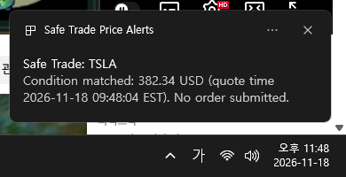

# 카카오페이증권 안전 거래 Codex 플러그인

[](https://github.com/sangmu1126/stock-helper-ai-plugin/actions/workflows/ci.yml)

카카오페이증권 관련 공개 자료에서 확인한 거래 안정성·신용거래 안내 문제를 바탕으로, **거래시간 변경 누락과 잘못된 신용 안내를 점검**하는 Codex 플러그인입니다. 사내용 스킬 2개와 일반 투자자용 스킬 1개로 구성됩니다. 별도 클라우드 배포나 외부 AI API 키 없이 로컬 Python으로 실행하며, 대화형 사용에는 Codex가 필요합니다.

**회사 공식 제품이 아니며, 카카오페이증권 내부 코드·문서를 제공받거나 내부 적용 효과를 검증한 것은 아닙니다.** 공개 보도는 문제의 배경이고, 기능 검증은 합성 자료·업계 공개 코드·실제 시세 알림을 구분해 수행했습니다. 장애가 시간 하드코딩 때문에 발생했다고 주장하지 않습니다.

## 한눈에 보기

| 항목 | 내용 |
| --- | --- |
| 형태 | Codex 플러그인 **0.7.2**(스킬 3개 + 로컬 런타임), Python 3.11+. 데스크톱 알림은 Windows 10/11 |
| 핵심 구조 | 판정은 결정적 코드가 맡고, 문장 이해·설명·코드 수정은 Codex가 맡음 |
| 근거 | 금감원 자료를 인용한 장애·민원 보도, 회사 공식 안내·공지, 거래소 발표 ([거래시간 근거](src/docs/MARKET_HOURS_EVIDENCE.md), [신용 가드 근거](src/docs/MARGIN_GUARD.md)) |
| 검증 | 합성 자료의 수정 전후 테스트, 공개 저장소 5곳의 정적 검사, 고정 원본 14개 파일의 해시 검증, 실제 시세의 Windows 알림 제출. CI는 pytest·ruff·JUnit 실행으로 구성 |
| 외부 연결 | 대화형 실행은 Codex 사용. 실사례 최초 다운로드는 GitHub, 실제 시세는 Yahoo Finance(yfinance). 카카오페이증권 주문·계좌 연결 및 실주문 없음 |

핵심 업무 결과물은 **위치·근거가 붙은 점검 보고서, 수정 제안 diff, 재검증 테스트**입니다. 일반 문장·JSON 초안은 Codex만으로도 만들 수 있으며, 플러그인은 반복 가능한 검사 코드와 출처 있는 규칙을 더합니다. 가격 알림은 이와 별도의 보조 기능입니다.

### 실행 기록과 외부 기여

- **공개 PR:** 한국투자증권 공식 저장소에서 폐지된 시간외 단일가 안내 12곳(예제 9곳, AI 코딩 도우미용 API 명세 3곳)을 수정하는 [PR #91](https://github.com/koreainvestment/open-trading-api/pull/91)을 제출했습니다. **2026-11-19 확인 시 OPEN·미머지**입니다. 설명 문구만 변경했으며 해당 TR의 현행 제공 시간은 확정하지 않았습니다. 재무 API 7종 종료 대응과는 별개이며, 내부 적용·운영 장애 해결을 의미하지 않습니다.
- **합성 입력의 실제 CLI 기록 (0.6.0):** [실행 요약](https://github.com/sangmu1126/stock-helper-ai-plugin/blob/main/docs/media/demo-evidence/summary.json), [변경 전 경계 테스트](https://github.com/sangmu1126/stock-helper-ai-plugin/blob/main/docs/media/demo-evidence/mhg-before-tests.txt), [수정 예제 경계 테스트](https://github.com/sangmu1126/stock-helper-ai-plugin/blob/main/docs/media/demo-evidence/mhg-after-tests.txt), [상담 문구 점검](https://github.com/sangmu1126/stock-helper-ai-plugin/blob/main/docs/media/demo-evidence/mrc-lint.txt), [반대매매 가드](https://github.com/sangmu1126/stock-helper-ai-plugin/blob/main/docs/media/demo-evidence/margin-guard.txt), [달러 조건 룰](https://github.com/sangmu1126/stock-helper-ai-plugin/blob/main/docs/media/demo-evidence/usd-rule.txt). 기존 합성 원본과 수정 예제를 따로 실행한 비교이며, Codex의 실시간 수정 녹화가 아닙니다.
- **가격 알림 실사용 흐름 (0.7.0):** 빈 작업 폴더에서 [초안](https://github.com/sangmu1126/stock-helper-ai-plugin/blob/main/docs/media/alert-flow/01-draft.txt) → [조건 확인](https://github.com/sangmu1126/stock-helper-ai-plugin/blob/main/docs/media/alert-flow/02-confirm.txt) → [등록](https://github.com/sangmu1126/stock-helper-ai-plugin/blob/main/docs/media/alert-flow/03-register.txt) → [감시](https://github.com/sangmu1126/stock-helper-ai-plugin/blob/main/docs/media/alert-flow/04-watch.txt) → [알림](https://github.com/sangmu1126/stock-helper-ai-plugin/blob/main/docs/media/alert-flow/05-notify.txt) → [Ctrl+C 중지](https://github.com/sangmu1126/stock-helper-ai-plugin/blob/main/docs/media/alert-flow/06-stop.txt)까지 이어서 실행했습니다([요약](https://github.com/sangmu1126/stock-helper-ai-plugin/blob/main/docs/media/alert-flow/summary.json)). 실제로 표시된 [Windows 알림 화면](https://github.com/sangmu1126/stock-helper-ai-plugin/blob/main/docs/media/alert-flow/notification.png)도 남겼습니다.
  - **1~6단계는 합성 시세(`demo-fixture`)입니다.** 조건이 맞도록 만든 가짜 가격이며, 알림 제목에 `[DEMO]`가 붙습니다.
  - **[7단계](https://github.com/sangmu1126/stock-helper-ai-plugin/blob/main/docs/media/alert-flow/07-real-quote.txt)는 실제 시세(Yahoo Finance)입니다.** 같은 룰을 실제 시세로 한 번 평가했습니다. 카카오는 Yahoo에 애프터마켓 시세가 없어 마지막 시세가 1시간 넘게 지난 정규장 종가였고, `STALE_QUOTE`로 알리지 않았습니다. TSLA는 미국 정규장 밖이라 `WAIT`였습니다.
  - **[미국 정규장 실제 시세 알림](https://github.com/sangmu1126/stock-helper-ai-plugin/blob/main/docs/media/us-real-alert/alert.txt)은 발송됐습니다.** 2026-11-18 미국 정규장(09:43~09:48 EST)에 TSLA·AAPL·NVDA 시세를 30초 간격으로 10번씩 받았더니 시세 나이가 모두 0~2초였습니다([표본](https://github.com/sangmu1126/stock-helper-ai-plugin/blob/main/docs/media/us-real-alert/quotes.txt)). 이어서 반드시 맞는 조건(TSLA 10,000달러 이하)으로 등록한 실제 시세 알림이 `[DEMO]` 없이 Windows에 제출됐습니다([알림 화면](https://github.com/sangmu1126/stock-helper-ai-plugin/blob/main/docs/media/us-real-alert/notification.png), [요약](https://github.com/sangmu1126/stock-helper-ai-plugin/blob/main/docs/media/us-real-alert/summary.json)).
- **화면 촬영:** [캡처 안내와 현재 상태](https://github.com/sangmu1126/stock-helper-ai-plugin/blob/main/docs/media/CAPTURE.md). 위 CLI 기록은 Codex 앱 화면 캡처나 실시간 수정 녹화가 아닙니다. 알림 화면만 실제 바탕화면을 잘라 저장했습니다.

CLI 기록은 `python tools/record_demo_evidence.py`로, 가격 알림 흐름은 `python tools/record_alert_flow.py --screenshot`(KRX 정규장 또는 애프터마켓 시간에 실행)으로, 미국 실제 시세 기록은 `python tools/record_us_real_alert.py --screenshot`(미국 정규장, 한국시간 겨울 23:30~06:00·여름 22:30~05:00)으로 다시 생성할 수 있습니다. 작업·사용자 경로 접두어만 가렸고 AI 전체 대화 로그는 변경하지 않았습니다.



실제 Windows 알림 화면입니다. TSLA 10,000 USD 이하라는 경로 확인용 조건으로 시험했으며 투자 전략·목표가 제안이 아닙니다. 위 증거 링크와 이미지는 공개 GitHub 자료라 인터넷 연결이 필요하고, 제출 ZIP에는 `docs/media/`나 기록 생성 도구가 포함되지 않습니다.

### 실제 공개 코드로 실행하기 (0.7.1)

합성 `toy-broker`와 별도로 **한국투자증권 공식 공개 원본**을 내려받아 검사하는 실행 예제를 제공합니다. 커밋 `74b0a082fa67a0be5bf53f561719c853890ed2df`(2026-11-16)과 SHA-256을 고정하며, 대상 코드는 실행하지 않습니다.

```bash
python src/skills/market-hours-guard/scripts/public_example.py --case hours --fetch
python src/skills/market-hours-guard/scripts/public_example.py --case retired-finance --fetch
```

| 실제 입력 | 실행 결과 | 확인 범위 |
| --- | --- | --- |
| 시간외 시세 예제 원본 7개 파일 | 폐지된 시간외 단일가 안내 **9곳 STALE**, 같은 구간 시작값은 **9곳 UNMAPPED** | 기존 거래시간 점검기로 설명 문구 검사. UNMAPPED는 오류 확정이 아니며 현행 TR 제공 시간은 미확인 |
| 재무분석 예제 원본 7개 파일 | 종료 공지 대상 **7종의 URL·TR ID·호출문 참조** | 명시적 7종 목록과 AST 정적 대조. 실제 API 호출·차단·장애는 검증하지 않음 |

[시간외 실사례 결과](src/skills/market-hours-guard/examples/public-kis/evidence/hours.json) · [재무 API 실사례 결과](src/skills/market-hours-guard/examples/public-kis/evidence/retired-finance.json) · [원본 출처와 해시](src/skills/market-hours-guard/examples/public-kis/manifest.json).

두 명령의 종료 코드 **1은 발견 항목 있음**, 2는 입력·다운로드·해시 오류입니다. 다운로드 후 `--fetch`를 빼면 오프라인으로 재현합니다. 결과와 원본은 `mhg-output/public-kis/<case>/`에 저장합니다. 원본 코드를 임의로 고치면 해시 검증에서 중단합니다.

**이것은 카카오페이증권 내부 코드 검증이 아니라 증권업계 공개 코드 적용 사례입니다.** 합성 예제의 `17 실패 → 50 통과`와 다른 실험이며, 이 공개 예제에서 경계 테스트 50건을 실행했다는 뜻이 아닙니다. 재무 API 공지의 제목·게시일은 [KIS 공식 포털](https://apiportal.koreainvestment.com/intro)에서 확인했지만, 시행 시각·7종 목록은 사용자가 제공한 본문에 근거하며 동적 본문은 독립적으로 확보하지 못했습니다. 원본의 재배포 라이선스를 확인하지 못해 제출물에는 다운로드 도구·출처·검사 메타데이터만 넣고 원본 코드는 포함하지 않습니다.

## 배경

2026년 AX 인재전쟁 해커톤의 카카오페이증권 과제에서 시작했습니다. 처음 만든 기능(감정적 매매를 안전한 룰 초안으로 바꾸기)은 회사 고유의 문제라는 공개 근거가 약했습니다. 그래서 이후 공개 자료로 입증되는 문제를 다시 찾았고, 문제와 해결이 직접 이어지는 기능 중심으로 다시 설계했습니다. 주제 선정 과정과 결정 기록은 [docs/reboot/](https://github.com/sangmu1126/stock-helper-ai-plugin/blob/main/docs/reboot/DECISION_LOG.md)에 있습니다.

## 누가, 무엇을 하나

| 대상 | 스킬 | 해결하는 일 | 공개 근거 |
| --- | --- | --- | --- |
| **사내 개발자·QA** | `market-hours-guard` | 코드·설정에서 거래시간 변경 누락 후보를 찾고, 연결된 동작을 경계 테스트로 확인. 검사 대상 밖인 파일·미확정 항목은 별도로 보고 | 회사 MTS 장애 42건을 집계한 보도. 업계에서는 거래시간 확대 첫날 SOR 관련 장애 발생. 회사 장애의 내부 원인을 시간 하드코딩으로 단정하지 않음 |
| **사내 상담 품질·QA·개발자** | `margin-rule-check` | 상담 스크립트·안내 문구·앱 설정·계산 코드의 담보비율·반대매매 일정이 공식 규칙과 맞는지 점검 | 상담 과정의 담보비율 오안내(120%로 안내, 실제 140%) 보도, 상반기 민원 829% 증가 |
| **일반 투자자** | `safe-trade-rule-builder` | 반대매매 기한·필요 금액·한시 유예를 출처와 함께 계산하고, 매매 요청을 수동 확인이 필요한 안전한 룰 초안으로 변환. 확인한 가격 알림은 PC에서 감시해 Windows 알림으로 보냄(주문 없음) | 신용공여 1년 새 168.5% 증가, 2026-11-06 반대매매 한시 유예 공지 |

## 동작 방식

```text
사용자 요청 (Codex 앱·CLI 채팅)
  → Codex가 요청에 맞는 스킬의 SKILL.md(작업 지침)를 읽음
  → Codex가 스크립트를 실행 (매매 요청은 Codex가 룰 JSON으로 만들어 전달)
  → 스크립트가 출처 붙은 규칙 파일로 계산·판정 (같은 입력이면 같은 결과)
  → Codex가 결과를 설명하고, 필요하면 코드·문서를 고친 뒤 다시 검사
  → (가격 알림) 사용자가 확인하면 Codex가 등록까지 하고, 감시는 PC 터미널의 로컬 프로세스가 이어서 맡음
```

별도 웹 화면은 없고 Codex 채팅이 인터페이스입니다. 가격 감시 결과는 Windows 알림으로 제출합니다. 아래 설치·실행 절차는 Codex CLI 기준이며, 플러그인을 지원하지 않는 IDE 확장 대화와 구분합니다.

## 설치와 실행

Python 3.11 이상이 필요합니다.

```bash
git clone https://github.com/sangmu1126/stock-helper-ai-plugin.git
cd stock-helper-ai-plugin
python -m pip install -r src/requirements.txt
python -m pytest -q
```

Windows 콘솔에서 한글이 깨지면 `$env:PYTHONIOENCODING="utf-8"`을 먼저 설정하세요.

점검 명령(`mhg.py scan`, `margin_rule_check.py lint`, `margin_check.py assess`)의 종료 코드 1은 실행 실패가 아니라 "고칠 것(또는 담보부족)이 있다"는 뜻입니다. CI에서 배포를 막는 용도로 씁니다.

**Codex에 플러그인으로 설치하려면**

1. 저장소 루트에 `.agents/plugins/marketplace.json`이 없으면 아래 내용으로 만듭니다. 이미 있으면 다른 플러그인 항목을 유지하고 `safe-trade-rule-builder`만 추가합니다. `.agents/`는 개인 설정이라 제출물에 포함하지 않습니다.

   ```json
   {
     "name": "personal",
     "interface": { "displayName": "Personal" },
     "plugins": [
       {
         "name": "safe-trade-rule-builder",
         "source": { "source": "local", "path": "./src" },
         "policy": { "installation": "AVAILABLE", "authentication": "ON_INSTALL" },
         "category": "Productivity"
       }
     ]
   }
   ```

2. 같은 폴더의 터미널에서 로컬 소스를 등록하고 설치한 뒤 새 세션을 시작합니다. 기존 마켓플레이스 이름이 `personal`이 아니면 설치 명령의 `@personal`을 해당 이름으로 바꿉니다.

   ```powershell
   codex plugin marketplace add .
   codex plugin add safe-trade-rule-builder@personal
   codex
   ```

3. **Codex 입력창**에서 `/plugins`로 설치 상태를 확인하고, `$market`를 입력해 자동완성의 `market-hours-guard`를 선택합니다. 아래는 실제 공개 코드 점검 요청입니다.

   ```text
   $market-hours-guard
   public_example.py로 hours와 retired-finance 사례를 실행해줘.
   --fetch로 공개 원본을 다운로드해도 돼.
   결과는 현재 작업 폴더의 mhg-output/public-kis에 저장해줘.
   커밋·해시·파일·행 번호와 검증하지 못한 범위를 보여줘.
   원본 수정·실행이나 증권사 API 호출은 하지 마.
   ```

다른 기능은 `$margin-rule-check`로 상담 문서 점검, `$safe-trade-rule-builder`로 반대매매 계산·가격 규칙 생성을 요청합니다. 초안 생성만으로 알림이 등록되거나 감시가 시작되지는 않습니다. 가격 알림은 조건 확인 후 등록하고 별도의 감시 터미널을 유지해야 합니다.

설치 후에는 **새 대화·CLI 세션**이 필요합니다. VS Code의 터미널에서 실행한 CLI는 사용할 수 있지만 **VS Code Codex 확장 대화에서는 플러그인을 지원하지 않습니다.** [공식 플러그인 안내](https://learn.chatgpt.com/docs/plugins) · [스킬 선택 문법](https://learn.chatgpt.com/docs/skills-and-plugins).

## 1. 거래시간 변경 점검기 (`market-hours-guard`, 사내 개발자·QA)

거래시간 규칙은 세션 판정, 주문 라우팅(SOR), 배치, 알림, 화면 문구에 흩어져 있습니다. 제도가 바뀌거나 특수일이 오면 그 값들이 같은 기준으로 함께 바뀌어야 합니다. 이 스킬은 승인된 기준표(TOML, 모든 값에 출처)와 코드·설정의 시각 표현을 대조합니다.

- **판정:** `STALE`(폐기된 기준값), `DST_RISK`(미국 시각을 한국시간 고정값으로 씀), `AMBIGUOUS`(의미 불명확), `UNMAPPED`(기준표에 없는 값), `MISMATCH`(주석과 값 불일치)
- **주석으로 의미 고정:** Codex가 고친 줄에 `mhg: <기준 ID>`를 답니다. 다음에 기준표가 바뀌면 그 줄이 자동으로 `MISMATCH`가 됩니다.
- **경계 시각 테스트:** 기준표에서 구간 경계 ±1초, 서머타임 전후, 특수일·휴장일 케이스를 생성합니다. Python 저장소는 pytest, Java·Kotlin 저장소는 JUnit 5(`--format junit`)로 만듭니다.
- **읽는 코드:** Python, Java·Kotlin(`LocalTime.of`), Spring cron(6필드), YAML·JSON·properties 설정, 주석·문서 속 시각.
- **CI와 PR 화면:** `--sarif`로 결과를 SARIF로 내보내면 GitHub code scanning이 PR의 해당 줄에 STALE·MISMATCH를 표시합니다. 이 저장소의 CI도 런타임 세션 설정을 이렇게 검사합니다.
- **기준표 변경 영향 미리보기:** 제도 변경 공지가 나오면 `impact`로 "새 기준표를 적용하면 어느 줄이 MISMATCH·STALE이 되는지"를 코드를 고치기 전에 봅니다.
- 표준 라이브러리만 씁니다.

```bash
python src/skills/market-hours-guard/scripts/mhg.py check-calendar --calendar src/skills/market-hours-guard/assets/calendar.demo.toml
python src/skills/market-hours-guard/scripts/mhg.py scan --repo src/skills/market-hours-guard/examples/toy-broker --calendar src/skills/market-hours-guard/assets/calendar.demo.toml
python src/skills/market-hours-guard/scripts/mhg.py gen-tests --calendar src/skills/market-hours-guard/assets/calendar.demo.toml --out mhg-output/junit --format junit --java-package toybroker
python src/skills/market-hours-guard/scripts/mhg.py scan --repo src/runtime --calendar src/skills/market-hours-guard/assets/calendar.demo.toml --sarif mhg-output/runtime.sarif
python -m pytest -q tests/market_hours_guard
```

합성 저장소(실제 회사 코드 아님) 결과입니다. Python판(`toy-broker`)과 Java판(`toy-broker-java`, Gradle·JUnit 5)이 같은 결과를 냅니다.

| 단계 | 정적 스캔 | 경계 테스트 50건 |
| --- | --- | --- |
| 수정 전 (`toy-broker`, `toy-broker-java`) | STALE 1 · DST_RISK 2 · AMBIGUOUS 1 · UNMAPPED 1 · MATCH 4 | 17 실패 |
| 수정 후 (`*-fixed`) | MATCH 16 (15개는 주석으로 의미 고정) | 50 통과 |

- 같은 `15:30`을 정규장 마감(정상), 과거 SOR 종료(변경 누락), 판단 보류로 구분합니다.
- 미국 장 시각을 한국시간으로 고정한 코드는 11월 1일 서머타임 해제 이후 케이스에서만 실패합니다.
- **수능일(2026-11-19)에는 정규장이 10:00~16:30, 애프터마켓이 17:00~20:00입니다.** 평소 시각을 쓰는 코드는 그날 09:00을 정규장으로, 15:30 이후를 장 종료로 잘못 판정합니다.
- **휴장일은 한국거래소가 공지한 달력(2026~2027년)을 씁니다.** 연말휴장일(12/31)처럼 공휴일이 아닌 휴장일을 모르는 코드는 그날 09:00을 정규장으로 판정합니다.
- 이 스킬로 투자자용 스킬과 로컬 런타임을 검사하면 거래시간 값이 모두 기준표와 일치합니다. 이 상태는 테스트로 고정돼 있습니다.
- 가상으로 SOR 종료를 21:00으로 바꾼 기준표를 `impact`에 넣으면, 주석을 단 2곳(라우터 상수, 정산 cron)이 새로 MISMATCH가 된다고 미리 알려 주고 종료 코드 1을 냅니다.

**공개 저장소 평가.** 증권사 공식 예제(한국투자, 키움)와 라이브러리·봇 등 공개 저장소 5곳에 돌렸습니다. API 코드 목록(`4:10~20`), 종목코드(`"005930"`), 슬라이스(`row[9:21]`)를 시각으로 읽던 문제를 수정한 뒤 남은 223건을 한 명이 수동 분류했고, 그 표본에서 시각이 아닌 판정은 0건이었습니다. **전체 오탐률 0%라는 뜻은 아닙니다.** 값만 같고 의미가 다른 MATCH는 20건 남았으며, 전체 재현율도 측정하지 않았습니다. 한국투자 공식 예제에서는 폐지된 시간외 단일가 안내 9곳을 STALE로 찾았습니다. 같은 안내가 API 명세 CSV에도 3곳 있었는데, 그때는 점검기가 CSV를 읽지 않아 PR 검토 중 별도 검색으로 찾았습니다. 0.7.2부터 CSV도 검사해 이 3곳도 STALE로 찾습니다. 1MB 초과 파일 등 남은 검사 한계는 [평가 문서](src/docs/MARKET_HOURS_REAL_REPOS.md)에 적었습니다.

자세한 설계는 [MARKET_HOURS_GUARD.md](src/docs/MARKET_HOURS_GUARD.md)에 있습니다.

## 2. 신용거래 규칙 점검 (`margin-rule-check`, 사내 상담 품질·QA·개발자)

보도된 담보비율 오안내는 상담 과정에서 "120%면 된다"고 안내한 사건이었습니다. 이 스킬은 그런 안내가 문서·스크립트·앱 설정·계산 코드에 남아 있는지 배포 전에 찾습니다. 규칙 값은 투자자용 스킬과 같은 파일(`config/margin_rules.json`)을 씁니다.

```bash
python src/skills/margin-rule-check/scripts/margin_rule_check.py lint --repo src/skills/margin-rule-check/examples/support-docs
python src/skills/margin-rule-check/scripts/margin_rule_check.py gen-tests --out mrc-output/tests
python src/skills/margin-rule-check/scripts/margin_rule_check.py gen-tests --out mrc-output/junit --format junit --java-package toymargin
python src/skills/margin-rule-check/scripts/margin_rule_check.py lint --repo src/skills/margin-rule-check/examples/support-docs --sarif mrc-output/mrc.sarif
```

- 문서는 md·txt·html·yaml·json 같은 텍스트와 **Word(.docx)** 를 읽습니다. Word는 문단 번호로 위치를 알려 줍니다. 옛 형식(.doc)과 한글(.hwp)은 읽지 않습니다.
- 계산 코드 테스트는 pytest와 **JUnit 5**(Java·Kotlin)로 만들 수 있습니다. Java판 가상 모듈(`toy-margin-service-java`)도 같은 결과를 냅니다.
- `--sarif`로 내보내면 잘못된 안내가 PR의 해당 줄(Word는 파일과 문단 번호)에 표시됩니다.

| 대상 (가상 자료) | 수정 전 | 수정 후 |
| --- | --- | --- |
| 상담 스크립트·앱 설정 lint | 고칠 것 5건: 잘못된 "안전" 안내 2, 유지비율 130%, D+3 반대매매, 반대매매 3영업일 설정 | 0건 |
| 계산 로직 경계 테스트 21건 (연말 휴장일을 건너뛰는 반대매매 날짜 포함) | 9 실패 | 21 통과 |

## 3. 안전 매매·반대매매 가드 (`safe-trade-rule-builder`, 일반 투자자)

투자자의 매수·매도·신용 요청을 규칙 초안과 설명으로 바꾸며 주문으로 연결하지 않습니다. 초안 생성은 형식·모호성·감정 표현·정책을 검사하고, 시세 평가·계좌 계산은 관련 데이터를 넣었을 때 수행합니다. 계좌 한도·브로커 상태·중복 실행 검사는 별도 로컬 런타임 이벤트 경로에 있습니다. 초안 출력만으로 이 모든 실시간 검사가 완료됐다고 해석하면 안 됩니다.

### 3-1. 반대매매 가드

신용으로 투자하는 고객이 반대매매를 피하려면 언제까지, 얼마를 넣어야 하는지 알아야 합니다. 기준(140% 유지, 120% 긴급, D+1·D+2, 한시 유예)은 상담 과정에서도 틀릴 만큼 복잡합니다.

- 신용 매수 요청이면 시작 담보비율과 140%·120%까지의 하락률을 계산하고 확인 질문을 붙입니다(`REQUIRE_CLARIFICATION`).
- 계좌 스냅샷을 넣으면 140% 회복에 필요한 입금액·상환액, 반대매매 예정일, 한시 유예 판정을 계산합니다. 날짜는 주말과 한국거래소 휴장일을 뺀 영업일로 셉니다(예: 12/30 담보부족 → 12/31 연말휴장일·1/1 신정을 건너뛰어 1/5 반대매매).
- "담보비율 150% 아래로 내려가면 알려줘"는 담보비율 알림 **초안**으로 처리합니다. 계좌를 자동 갱신해 계속 감시하는 기능은 없으며, 아래 가격 감시기에 등록하는 종목 가격 규칙과 다릅니다.

```bash
python src/skills/safe-trade-rule-builder/scripts/margin_check.py assess --account src/skills/safe-trade-rule-builder/examples/margin/misguided_after_deposit.json
python src/skills/safe-trade-rule-builder/scripts/rule_builder.py --intent "담보비율 120%만 맞추면 반대매매 안 되지?" --format markdown
```

오안내 유형을 본뜬 **가상 계좌**에서는 7,600만 원을 입금해 127.2%가 돼도, 그날 120% 미만이었다면 당일 140% 회복 의무가 남아 다음 영업일 반대매매 대상으로 계산됩니다. 예제 계산 결과는 추가 입금 64,000,000원 또는 상환 45,714,286원입니다. 공식 안내에 없는 계산식에는 업계 일반식 가정을 쓰며 이자·수수료와 시세 변동을 제외합니다. 실제 계좌의 비율·일정은 증권사 앱 표시를 우선합니다.

### 3-2. 안전 매매 룰

- **문장 해석:** Codex가 사용자 문장을 룰 JSON으로 만들어 넘기면(`--rule-json`) 스크립트가 형식 검증, 정규화, 안전 규칙, 정책 판단을 합니다. 외부 AI API는 쓰지 않습니다. JSON 없이 실행하면 오프라인 파서가 해석합니다.
- **세션과 시간 조건:** 정규장, KRX 애프터마켓(16~20시), "장 초반 제외", "오전 제외", "장 마감 30분 전에만"을 종목 시장의 현지 시각으로 판정합니다. 미국 종목은 뉴욕 시간 기준이라 서머타임 전후에도 맞습니다. 한국거래소·NYSE 휴장일과 수능일·미국 조기 폐장 같은 특수일 일정도 반영합니다. 휴장일 달력이 공지되지 않은 날짜, 공지되지 않은 세션, "3일 연속" 조건은 통과시키지 않습니다.
- **가격과 통화:** "4만원 아래로", "200달러 아래로", "$180 넘으면"을 통화와 함께 인식합니다. 원화 조건을 달러 시세와 비교하는 일은 막습니다(`TRIGGER_CURRENCY_MISMATCH`).
- **종목과 금액:** 국내 23개·미국 15개 주요 종목, 6자리 코드, 미국 티커를 인식합니다. "100만원 매수", "1,000,000원", "1억원" 같은 금액은 인식하고, 가격 조건에 쓰인 금액은 주문 금액으로 보지 않습니다.
- **감정 점검:** 손실 회복, FOMO, 몰빵, 조급함 표현이 있으면 확인 질문으로 낮춥니다.

```bash
python src/skills/safe-trade-rule-builder/scripts/rule_builder.py --intent "카카오가 전일 종가보다 3% 떨어지면 장 마감 30분 전에만 10만원만 매수 후보로 알려줘. 하루 한 번만." --rule-json src/skills/safe-trade-rule-builder/references/rule_json_example.json --format markdown
python src/skills/safe-trade-rule-builder/scripts/rule_builder.py --intent "테슬라가 200달러 아래로 내려가면 알려줘" --format markdown
python src/skills/safe-trade-rule-builder/scripts/rule_builder.py --intent "카카오가 3% 떨어지면 알려줘" --backtest --provider demo-fixture --format markdown
```

### 3-3. 로컬 가격 감시와 Windows 알림 (0.7.0)

가격 알림은 초안 생성에서 끝나지 않습니다. 확인한 알림 전용 규칙을 SQLite에 등록하고, 로컬 감시 프로세스가 조건을 반복 평가해 Windows 작업 표시줄 알림으로 제출합니다. 실주문은 하지 않습니다.

> **알려진 한계: 국내(KRX) 종목은 실제 시세로 알림이 사실상 발송되지 않습니다.**
> - 감시는 15초보다 오래된 시세로는 알리지 않습니다. Yahoo의 KRX 시세는 20분 지연("Delayed Quote")이고 애프터마켓 시세는 없습니다. 그래서 국내 종목을 `yfinance` 공급자로 등록하면 가격 조건이 맞아도 `STALE_QUOTE`로 멈춥니다. 이 경우 `alert_watch.py add`가 등록 결과에 `KRX_QUOTES_DELAYED` 경고를 붙이고 삭제 명령을 안내합니다.
> - 2026-11-18 미국 정규장의 TSLA·AAPL·NVDA 표본에서는 제공 시각과 조회 시각 차이가 0~2초였고, TSLA 시험 알림이 Windows에 제출됐습니다([기록](https://github.com/sangmu1126/stock-helper-ai-plugin/blob/main/docs/media/us-real-alert/alert.txt)). 제공자 메타데이터에는 `exchangeDataDelayedBy=15`와 `quoteSourceName=Nasdaq Real Time Price`가 함께 있었습니다. **5분간의 타임스탬프 표본이지 모든 종목·시점의 실시간성이나 거래소 대비 지연을 보증하는 측정은 아닙니다.**
> - 미국 정규장 밖에는 현재 감시기가 세션 검사에서 대기합니다. 확장시간 시세를 받더라도 장 전·장 후 알림을 지원하는 것으로 간주하지 않습니다.
> - 지연된 가격으로 "떨어졌다"고 알리면 이미 움직인 시장을 보고 판단하게 되므로 15초 기준은 완화하지 않았습니다. 국내 종목을 실제 시세로 알리려면 실시간 시세 공급자 연결이 필요합니다.

1. 아래 명령으로 초안을 저장하고 종목·통화·가격·세션·쿨다운을 확인합니다. 예시는 TSLA 200 USD 이하, 미국 정규장, 10분 쿨다운입니다. `price_cross_below`는 기존 평가기의 포함 비교(`<=`)를 사용하며, 엄격한 미만 비교가 아닙니다.

```powershell
$scripts = (Resolve-Path src/skills/safe-trade-rule-builder/scripts).Path
python "$scripts/rule_builder.py" --intent "테슬라가 200달러 아래로 내려가면 알려줘" --save-draft rule-output/tsla.json --format markdown
```

2. 값을 확인한 뒤 `--confirm`으로 등록합니다. 등록만으로 감시는 시작되지 않습니다.

```powershell
python "$scripts/alert_watch.py" add --draft rule-output/tsla.json --intent "테슬라가 200달러 아래로 내려가면 알려줘" --confirm
python "$scripts/alert_watch.py" setup-notifications
python "$scripts/alert_watch.py" test-notification
python "$scripts/alert_watch.py" run --interval 60
```

`run` 터미널을 열어 둔 동안 60초 간격으로 확인합니다. `Ctrl+C`는 감시를 종료하고 등록·쿨다운 기록은 남깁니다. 재부팅·절전·프로세스 종료 후에는 자동 재시작하지 않습니다. `run --once`는 한 번만 평가하는 검사이며 지속 감시가 아닙니다.

`setup-notifications`는 현재 사용자의 알림 앱 식별자와 표시명만 등록하며 알림 허용·방해 금지·보안 설정은 변경하지 않습니다. Windows 의존성은 `python -m pip install -r src/requirements.txt`로 설치합니다.

3. 다른 터미널에서 같은 프로젝트 폴더로 이동하고 `$scripts`를 다시 설정하면 상태·기록을 확인하고 중지·재개·삭제할 수 있습니다. 기본 DB는 현재 작업 폴더의 `rule-output/alerts.sqlite3`이며 다른 경로는 모든 명령에 동일하게 `--db <경로>`를 서브명령 앞에 지정합니다.

```powershell
python "$scripts/alert_watch.py" status
python "$scripts/alert_watch.py" list
python "$scripts/alert_watch.py" events
python "$scripts/alert_watch.py" pause <rule-id>
python "$scripts/alert_watch.py" resume <rule-id>
python "$scripts/alert_watch.py" remove <rule-id>
```

**범위와 한계:** 시세는 기존 yfinance 공급자(Yahoo Finance)를 사용하며 카카오페이증권 연동이 아닙니다. 15초보다 오래된 시세, 통화·종목 불일치, 휴장·장외 시각, 정책 위반에서는 발송하지 않습니다. 국내 종목의 실제 시세 지연 한계와 미국 정규장 실측 결과는 이 절 맨 위에 적었습니다. 폴링 사이의 가격 변동도 놓칠 수 있어 실시간·무누락 알림을 보장하지 않습니다. 가격 조건이 계속 맞으면 쿨다운마다 재알림할 수 있습니다. Windows 알림 설정·방해 금지에 따라 표시되지 않을 수 있으며 `submitted`는 OS 제출이지 수신·열람 확인이 아닙니다.

만료·연속일 조건, 뉴스·거래량·수동 검토 취소 조건은 자동으로 처리할 수 없어 등록 시 거절합니다. 계좌 자동 갱신·담보비율 지속 감시, 휴대폰 푸시·이메일, 로그인 시 자동 시작은 제공하지 않습니다. 발송 실패는 기록하고 새 시세에서 최소 60초 후 재시도합니다. OS 제출 직후 프로세스가 종료되면 기록 시점 차이로 재시작 후 중복이 생길 수 있어 정확히 한 번 전달을 보장하지 않습니다. 일시정지·삭제 전 이미 진행 중인 알림은 제출될 수 있습니다.

네이티브 알림은 Windows SDK 바인딩을 제공하는 [Windows-Toasts](https://windows-toasts.readthedocs.io/en/latest/)를 사용합니다. 초안·계좌·등록 DB·알림 이력은 `rule-output/` 아래 로컬 파일이므로 제출물이나 공개 저장소에 포함하지 마세요. 이전 설치본은 새 소스를 반영하도록 플러그인을 다시 설치하고 새 세션을 시작해야 합니다.

### 3-4. 로컬 런타임

`src/runtime/runtime_handler.py`의 `handle_event(event)`가 룰 이벤트(시세, 브로커 상태, 계좌 한도 포함)를 받아 결정을 냅니다. 결정은 `STOP`, `WAIT`, `NOTIFY_ONLY`, `MANUAL_CONFIRM`, `REQUIRE_CLARIFICATION`, `BLOCK` 중 하나입니다. 세션 시간, 휴장일, 특수일은 `src/runtime/market_sessions.json`에 있고, 스킬과 런타임이 함께 씁니다.

| 설정 | 동작 |
| --- | --- |
| 기본값 (`memory`) | 호출마다 새 메모리 저장소. 테스트·데모용 |
| `SAFE_TRADE_STATE_BACKEND=file` + `SAFE_TRADE_STATE_FILE` | 중복 실행 차단·쿨다운을 로컬 JSON 파일에 유지. 실행이 바뀌어도 같은 결정이 다시 나오지 않음 |
| `SAFE_TRADE_DECISION_LOG_BACKEND=file` + `SAFE_TRADE_DECISION_LOG_FILE` | 감사 로그를 로컬 JSONL 파일에 추가 |
| `SAFE_TRADE_METRICS_LOG=0` | 표준 에러로 남기는 지표 로그 끄기 |
| `SAFE_TRADE_POLICY_CONFIG_PATH` 등 | 정책·리스크·프롬프트 보안 규칙 JSON 경로 바꾸기(재시작 없이 다시 읽음) |

## 설계 결정

- **판정은 코드, 이해는 Codex.** 숫자와 규칙 판정을 AI에 맡기지 않습니다. Codex는 문장 이해, 룰 JSON 작성, 결과 설명, 코드 수정을 맡습니다.
- **외부 AI API 없음.** Codex 자체가 언어 모델이라, 스크립트 안에서 다시 AI API를 부르는 것은 중복 비용이자 실패 지점이었습니다. 그래서 제거했습니다.
- **클라우드 없음.** 처음에는 AWS Lambda·DynamoDB로 배포했지만 플러그인 흐름에서 쓰이지 않았고 심사자·사용자가 실행해 볼 수도 없었습니다. 로컬 저장소로 같은 기능(중복 차단, 쿨다운, 감사 로그)을 유지하고 AWS 리소스는 백업 후 삭제했습니다.
- **공개 규칙과 제품 가정을 구분.** 거래시간 기준표와 신용 규칙 파일은 출처 ID를 사용합니다. 합성 기준표의 `DEMO`, 담보 계산의 업계 일반식 등은 회사 공식 규칙이 아닌 가정으로 표시합니다. 출처가 있다는 것과 공식 자료로 모든 값이 검증됐다는 것은 다릅니다.
- **같은 기준 공유.** 런타임 세션 설정과 거래시간 기준표, 투자자용 반대매매 계산과 사내용 규칙 점검이 같은 값을 쓰는지 테스트가 지킵니다.
- **확인 못 하면 통과 안 함.** 공지되지 않은 세션, 휴장일 달력 범위 밖 날짜, 통화가 다른 가격 조건, 단일 시세로 확인할 수 없는 조건, 저장소·설정 오류는 모두 `WAIT`나 `STOP`으로 처리합니다.
- **감시는 로컬 프로세스, 오래된 시세로는 알리지 않음.** Codex는 대화가 진행되는 동안만 동작하고, 웹에서 읽은 가격은 몇 초 전 값인지 확인할 수 없습니다. 그래서 Codex를 시세 공급원으로 쓰지 않고 등록까지만 맡깁니다. 감시는 PC의 로컬 프로세스가 맡아 시세 원래 시각으로 나이를 다시 계산하고, 15초보다 오래된 시세로는 알리지 않습니다. 이미 움직인 가격으로 판단하게 하지 않으려는 것이며, 그 대가로 Yahoo가 20분 늦게 주는 국내 종목은 알림이 나가지 않는 한계를 받아들였습니다.

## 검증

2026-11-19 로컬 점검: **372개 통과, JUnit 환경이 필요한 4개 건너뜀**. `ruff check src tests tools`, README의 로컬 링크·공개 증거 경로 및 실사례 파일의 제출 포함 여부 검사도 통과했습니다. 이 결과는 현재 작업 트리 기준이며 공개 저장소 CI의 새 커밋 통과를 의미하지 않습니다.

```bash
python -m pytest -q
ruff check src tests tools
```

- 테스트는 파이썬 경로 설정 없이 실행합니다. CI(GitHub Actions)에서 린트와 함께 실행합니다.
- 그중 4개는 생성된 JUnit 테스트를 실제로 컴파일·실행합니다. JDK와 JUnit 콘솔 런처(`JUNIT_CONSOLE_JAR`)가 없으면 로컬에서는 건너뛰고, CI에서는 실패로 처리합니다.
- 플러그인 소스에 클라우드 SDK나 외부 AI API SDK가 없다는 것도 테스트로 확인합니다.

CI 배지는 공개 저장소의 커밋 상태를 보여주며 아직 커밋·푸시하지 않은 로컬 변경의 검증 결과를 대신하지 않습니다. 과거 실행 기록의 버전·커밋은 각 `summary.json`을 기준으로 읽어야 합니다.

## 제출 ZIP

저장소 루트에서 아래 명령으로 구조를 확인하고 패키징합니다. 이 도구는 개발 저장소용이며 제출 ZIP 자체에는 `tools/`, `tests/`, 루트 `docs/`가 들어 있지 않습니다.

```bash
python tools/package_submission.py --check-only
python tools/package_submission.py --output submission.zip
```

```text
submission.zip
├── src/        # 전체 플러그인 루트, 실사례 manifest·검사 결과 포함
├── README.md
└── logs/       # 전체 AI 대화 원본(md/txt/json/jsonl)
```

패키징은 Git 추적 파일과 무시되지 않은 새 `src/` 파일을 포함하되 캐시·빌드 산출물·`src/` 내부의 로그 복사본은 제외합니다. 루트 `logs/`는 추적 여부와 무관하게 전체를 포함하며 편집하지 않습니다. 제출 전 모든 사용 도구의 대화가 빠짐없이 수집됐는지 직접 확인해야 하며, 구조 검사만으로 로그의 완전성·비밀정보 부재가 증명되지는 않습니다. 인증정보·실제 고객 계좌·다운로드 원본·로컬 알림 DB는 제출하지 않습니다.

ZIP으로 시작할 때도 압축을 푼 폴더가 작업 루트입니다. 위 설치 절차의 `./src`를 그대로 사용하고, 실사례 실행은 `src/skills/market-hours-guard/scripts/public_example.py`로 할 수 있습니다. 테스트·기록 재생성 도구가 필요하면 전체 Git 저장소를 사용합니다.

## 프로젝트 구조

```text
src/                                  # Codex 플러그인 루트
├── .codex-plugin/plugin.json
├── skills/
│   ├── market-hours-guard/           # 사내 개발자·QA: 거래시간 변경 점검
│   ├── margin-rule-check/            # 사내 상담 품질·QA·개발자: 신용거래 규칙 점검
│   └── safe-trade-rule-builder/      # 일반 투자자: 반대매매 가드 + 안전 매매 룰 + 가격 알림(alert_watch.py)
├── runtime/                          # 룰을 평가하는 로컬 런타임 (세션 설정 공용)
├── docs/                             # 근거·설계 문서, 프로젝트 요약
└── requirements.txt
tests/                                # 스킬·런타임·로컬 알림 테스트
docs/reboot/                          # 주제 선정 과정, 결정 기록, 보관 자료
docs/media/                           # 실제 CLI 실행 기록과 알림 화면 (demo-evidence, alert-flow, us-real-alert)
tools/
├── record_demo_evidence.py           # 사내용 스킬·반대매매 가드 실행 기록 생성
├── record_alert_flow.py              # 가격 알림 흐름 기록 (합성 시세 + 국내 실제 시세 1회)
├── record_us_real_alert.py           # 미국 정규장 실제 시세 나이 측정과 실제 알림 1회
├── package_submission.py             # 해커톤 제출 zip 생성
└── save_log.py                       # 해커톤 제공 대화 로그 저장 훅
```

## 한계

- 사내용 스킬은 합성 자료와 증권업계 공개 코드로 검증했습니다. 카카오페이증권 내부 코드·문서의 결함을 발견했거나 실제 장애·민원을 줄였다는 실증 결과는 없습니다. 공개 보도만으로 내부 원인을 시간 로직 오류로 단정할 수 없습니다.
- 거래시간 점검기의 MATCH는 "기준표에 있는 값"이라는 뜻입니다. 공개 저장소에서는 값만 같은 MATCH가 있었습니다(97건 중 37건, 수능일 기준을 고친 뒤 80건 중 20건). 그래서 고칠 대상은 문맥을 확인해 주석으로 의미를 고정합니다.
- 담보비율 계산식은 공식 안내에 없어 업계 일반식을 쓰며, 출력에 "앱 표시값 우선"을 표시합니다.
- 휴장일 달력은 거래소가 공지한 2027년 말까지만 들어 있습니다. 그 뒤 날짜는 세션 판정에서 `WAIT`로 두고 반대매매 날짜 계산에는 경고를 붙이므로, 매년 공지를 받아 갱신해야 합니다. 특수일은 공지가 확인된 날만 넣습니다.
- 카카오페이증권 주문·계좌 API에는 연결하지 않았습니다. 시세는 yfinance 또는 합성 공급자를 쓰고, 계좌 정보는 사용자가 제공한 스냅샷으로만 계산합니다.
- 가격 알림은 PC에서 감시 프로세스를 켜 둔 동안만 동작합니다. 자동 시작, 휴대폰 푸시, 계좌 담보비율 상시 감시는 없습니다.
- 국내(KRX) 종목은 Yahoo 시세가 20분 지연이라 실제 시세로는 알림이 사실상 나가지 않습니다. 미국 종목은 정규장 중에만 알립니다([3-3](#3-3-로컬-가격-감시와-windows-알림-070) 참고).

## 안전 고지

이 플러그인은 투자 조언, 종목 추천, 수익 보장, 실주문 시스템이 아닙니다. 백테스트는 과거 조건 발동 양상을 보는 안전성 검토이지 미래 성과 예측이 아닙니다. 모든 주문 판단은 사용자가 증권사 화면에서 직접 확인해야 합니다.

## 변경 이력

- **2026-07 (해커톤 예선):** Safe Trade Rule Builder. 감정적 매매 의도를 안전한 룰 초안으로 바꾸고, AWS Lambda·DynamoDB 런타임과 GPT API 파서를 붙였습니다.
- **2026-11 (재설계):** 공개 근거를 다시 조사해 거래시간 변경 점검기와 반대매매 가드를 추가하고, 사용자 대상별로 재정리했습니다.
- **2026-11 (정리·확장):**
  - AWS를 제거해 로컬 전용으로 바꾸고, 외부 AI API를 제거했습니다(Codex가 룰 JSON 작성).
  - 세션 판정을 공통화했습니다(애프터마켓, 수능일, 로컬 런타임 시간 조건).
  - 한국거래소·NYSE 공식 휴장일 달력(2026~2027)과 미국 조기 폐장을 세션 판정, 반대매매 영업일 계산, 두 사내용 스킬의 테스트 생성에 반영했습니다.
  - 사내용 스킬 두 개가 JUnit 5 테스트도 만들고(Java·Kotlin 저장소), 신용 규칙 점검이 Word(.docx)를 읽습니다. 공개 증권 저장소 5곳으로 거래시간 점검기를 평가해 오탐 원인 3가지를 고쳤습니다.
  - 두 사내용 스킬이 SARIF로 결과를 내보내 PR 화면에 표시하고, 거래시간 점검기에 기준표 변경 영향 미리보기(`impact`)를 더했습니다. 수능일 기준값이 우연히 MATCH 되던 문제를 고쳤습니다(값만 같은 MATCH 37건 → 20건).
  - 달러 가격 조건과 사내용 신용 규칙 점검을 추가하고, CI 린트를 다시 켰습니다.
- **2026-11 (0.7.0 가격 알림):**
  - 확인한 알림 전용 룰을 로컬 SQLite에 등록하고, 로컬 감시 프로세스가 60초마다 평가해 Windows 알림으로 보냅니다(일시정지·재개·삭제, 쿨다운, 이력 보존, 주문 없음).
  - 빈 작업 폴더에서 초안부터 Ctrl+C 중지까지 실행해 기록했고, 미국 정규장 실제 시세(시세 나이 0~2초)로 실제 알림이 나가는 것을 확인했습니다.
  - 국내 종목은 Yahoo 시세 지연으로 알림이 나가지 않는 한계를 명시하고, 그런 룰을 등록하면 CLI가 경고합니다.
- **2026-11-19 (0.7.1 실제 공개 예제):** 한국투자증권 공개 원본 14개를 고정 커밋·SHA-256으로 검증해 시간외 안내 9곳과 재무 API 7종의 참조를 재현했습니다. 합성 테스트와 분리했고 실제 API 호출·차단 검증, 내부 시스템 적용은 수행하지 않았습니다.
- **2026-11-19 (0.7.2 CSV 검사):** 거래시간 점검기가 CSV도 검사합니다. 공개 저장소 평가에서 놓쳤던 한국투자 API 명세 `data.csv`의 폐지 안내 3곳을 STALE로 찾고, 5개 저장소의 기존 판정은 하나도 바뀌지 않았습니다. 시세·체결 기록처럼 시각이 값인 행은 판정하지 않고, 건너뛴 수와 파일을 보고서에 남깁니다.
