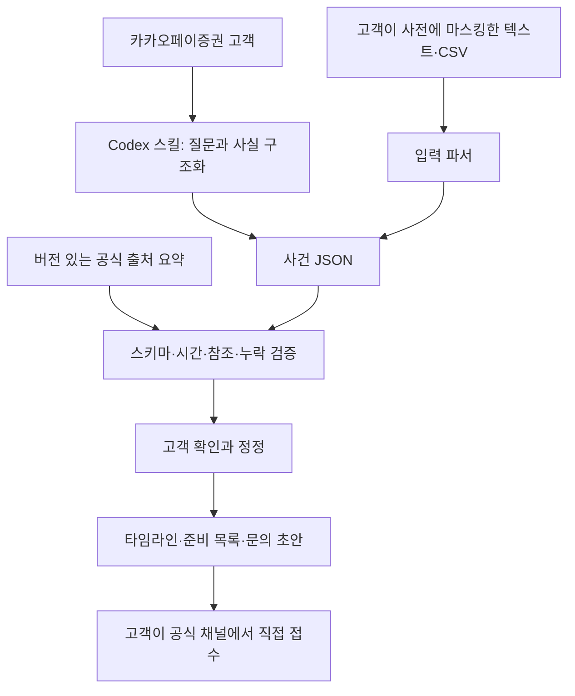

# 카카오페이증권 고객 문제에서 다시 시작하는 플러그인 설계

작성일: 2026-11-18 (Asia/Seoul)  
문서 버전: 0.1  
상태: 보류된 후보 설계. 문의 준비의 고객 불편 근거가 부족하여 주제를 재검토 중. 신규 기능은 미구현.  
관련 자료: [공개 근거 기록](EVIDENCE.md), [구현 스펙](SPEC.md)

이 문서는 문제 선정과 제품 설계를 설명한다. 기술 선택, 실제 구현 계약, 완료 기준은 `SPEC.md`를 기준으로 한다. 아래 JSON은 개념 예시이며 최종 입력 스키마는 구현 스펙의 모델 계약으로 구체화한다.

후속 조사: [문제 후보 재조사](RESEARCH_02.md). 아래 주제는 현재 채택된 최종안이 아니다.

## 1. 제안 주제

**카카오페이증권 거래 장애를 겪은 고객이 사실관계와 증거를 정리하고, 공식 문의·보상 검토 요청을 준비하도록 돕는 Codex 플러그인.**

가칭은 `거래장애 기록 도우미`, 패키지 이름은 `trade-incident-helper`로 한다.

고객은 자신이 겪은 일을 설명하고 보유 자료를 제공한다. 플러그인은 시간순 기록, 확인되지 않은 사실, 부족한 자료, 출처가 붙은 절차 안내, 고객이 검토할 문의서 초안을 만든다.

직접 사용자와 수혜자는 모두 카카오페이증권 고객이다. 상담원이나 개발자의 운영 도구로 대상을 바꾸지 않는다. 과제의 기업·산업·고객 범위 중 고객 문제를 선택한다.

## 2. 과제와의 연결

사용자가 제공한 과제 문구는 다음과 같다.

> 그 기업, 그 기업의 산업, 또는 그 기업의 고객이 겪는 실제 문제를 공개 자료로 입증하고, 이를 해결하는 Codex 플러그인을 제출하세요.

| 과제 요소 | 이번 설계에서의 대응 |
| --- | --- |
| 선택 기업 | 카카오페이증권 한 곳 |
| 실제 고객 문제 | 거래 장애 경험과 후속 문의 준비 |
| 공개 입증 | E1·E4의 사건 보도, E2·E3의 공식 절차 |
| 해결 범위 | 고객의 기록 정리, 자료 누락 발견, 문의 초안 작성 |
| Codex 플러그인 | 스킬과 로컬 검증·문서 생성 코드 |
| 시연 | 가상 사건 자료를 넣고 근거 연결이 있는 접수 준비 묶음 생성 |
| 제출 | `src/.codex-plugin/plugin.json`, 실행 요소, README, 전체 AI 대화 로그 |

## 3. 왜 주제를 바꾸는가

기존 Safe Trade Rule Builder는 자연어 매매 의도와 감정적 판단을 다루었다. 그러나 지금까지 모은 기업별 공개 자료는 그 문제를 직접 뒷받침하지 못했다.

새 설계는 출처로 확인된 사건에서 시작한다. 문제와 기능의 연결은 다음과 같다.

| 공개 사실 | 고객 관점의 작업 | 설계할 기능 |
| --- | --- | --- |
| 실제 주문·접속 장애와 고객 불편이 보도됨 [E1] | 내가 경험한 사건을 설명 | 진술과 자료를 시간순으로 정리 |
| 공식 절차에 여러 확인 항목이 있음 [E2] | 무엇을 확인하고 준비할지 파악 | 출처와 조건이 연결된 준비 목록 |
| 공식 접수 채널이 존재함 [E3] | 준비한 내용을 직접 전달 | 문의 초안과 첨부 목록 생성 |
| 일부 서비스 지연과 주문 불가는 다를 수 있음 [E4] | 경험을 과장하지 않고 전달 | 현상 분류, 불명확하면 질문 |

기록 준비가 어렵다는 정도와 도구의 효과는 별도 검증한다. 공개 기사만으로 이 부분까지 입증했다고 쓰지 않는다.

## 4. 문제 후보 비교

아래 평가는 조사 결과에 대한 설계자의 정성적 판단이다. 시장 규모나 고객 선호 점수가 아니다.

| 후보 | 공개 근거 | 기존 해결 수단 | 추가 검증 과제 | 이번 결정 |
| --- | --- | --- | --- | --- |
| 거래 장애 후 기록·문의 준비 | 실제 불편 보도와 공식 절차가 함께 있음 [E1~E4] | 공식 공지와 고객센터 | 실제 준비 부담, Codex 접근성 | 우선 설계 |
| 타사 해외주식 세금 자료 취합 | 과거 공식 자료 제출 안내 [E5] | 신고 대행 서비스가 이미 있음 | 최신 대행 범위와 잔여 불편 | 보류 |
| 기업행사로 인한 잔고·거래 제한 설명 | 과거 권리발생 공지 [E6] | 종목별 공식 공지 | 최신 사례와 실제 고객 혼란 | 보류 |
| 감정적 매매 의도 점검 | 현재 수집 자료로 기업별 근거 부족 | 기존 프로젝트 프로토타입 | 실제 문제와 효과의 입증 | 신규 주제에서 제외 |

선정 이유는 특정 사건, 공식 기준, 고객 결과물을 연결하는 시연을 만들 수 있기 때문이다. 보상금 증가나 장애 예방을 선정 근거로 삼지 않는다.

## 5. 사용자와 사용 시점

주 사용자는 장애를 경험한 뒤 문의를 준비하는 개인 고객이다. 자료를 정리할 수 있는 PC 환경에서 Codex를 사용하는 고객을 초기 검증 대상으로 한다.

핵심 사용 시점은 **장애 후 기록 정리**다. 장애가 진행 중인 고객에게는 먼저 검증된 공식 대응 경로를 보여주고, 긴 문답이나 파일 작업이 대응을 지연시키지 않게 한다. 프로그램이 주문·통화·민원 접수를 대신 실행하지 않는다.

고객이 얻어야 하는 결과는 다음과 같다.

- 자신이 한 행동과 확인된 기록을 구분한 사건 요약.
- 시간이 서로 맞지 않거나 확인되지 않은 항목 목록.
- 공식 기준과 연결된 추가 확인 목록.
- 직접 읽고 수정한 후 공식 채널에 전달할 문의서 초안.

### Codex 적합성에 대한 가설

여러 텍스트·CSV 파일을 한 사건으로 묶고, 수정 후 문서를 다시 생성하고, 항목별 근거를 추적하는 데 플러그인이 도움을 줄 수 있다. 기술적 구성 가능성은 [T1·T2](EVIDENCE.md)로 확인했다.

다만 일반 고객에게 Codex 설치·사용은 장벽일 수 있다. 일반 채팅의 문서 작성 기능 대비 효과도 입증되지 않았다. 실제 고객 5명의 사용 관찰에서 3명 이상이 도움 없이 입력·초안 검토를 완료하지 못하면, 이 주제의 Codex 직접 사용 적합성을 재검토한다. 이때 고객 대상을 조용히 운영자로 바꾸지 않는다.

## 6. 대표 사용자 흐름

예시 자료는 모두 합성 데이터이며 실제 고객 진술이나 실제 거래내역이 아니다.

1. 고객이 “어젯밤 주문 버튼이 반응하지 않았고, 문의할 자료를 정리하고 싶다”고 요청한다.
2. 플러그인이 진행 중인 장애인지 먼저 확인하고, 민감정보를 대화·첨부 전에 가리도록 안내한다.
3. 고객은 날짜·시간대, 관찰한 현상, 시도한 행동을 설명한다. 기억이 불확실하면 불확실한 상태로 받는다.
4. 고객이 준비한 마스킹 텍스트·CSV를 읽고 각 주장에 파일·행 번호를 연결한다.
5. Codex는 모호한 정보를 정리하고, 결정적 코드가 시간·필수 항목·참조 무결성을 검사한다.
6. 날짜와 장애 유형에 맞는 공식 자료가 있는지 확인한다. 사건별 공지가 없으면 접수기한은 미확인으로 둔다.
7. 고객에게 시각 충돌, 누락 항목, 미확인 진술을 먼저 보여준다.
8. 고객 확인 후 Markdown 초안과 기계 판독용 JSON을 생성한다.
9. 고객이 공식 채널에서 별도로 접수한다. 생성 완료와 접수 완료를 구별한다.

처음부터 모든 빈칸을 채우도록 요구하지 않는다. 모르는 사실을 포함한 초안도 생성할 수 있으며, 누락 상태를 표시한다.

## 7. MVP 기능 범위

| 기능 | MVP 동작 | 완료 기준 |
| --- | --- | --- |
| 사건 인터뷰 | 날짜·현상·행동·보유 자료를 구조화 | 모르는 값은 `null` 또는 `unknown` |
| 텍스트·CSV 읽기 | 고객이 미리 가린 자료만 입력 | 형식 오류를 위치와 함께 반환 |
| 타임라인 | 원래 표기와 시간대를 유지 | 미확인 시간대를 임의 환산하지 않음 |
| 근거 연결 | 진술·파일·공식 자료를 구분 | 모든 사실 항목에 참조 또는 자기진술 표시 |
| 누락·충돌 검사 | 필수 정보, 참조, 시각 충돌 점검 | 오류와 질문 목록이 재현 가능 |
| 절차 안내 | 버전이 있는 공식 출처 요약 | 확인일·적용 시점·미확인 사항 노출 |
| 초안 생성 | 사건 요약, 준비 목록, 문의서 | JSON과 Markdown 내용 일치 |
| 수정 반영 | 고객 정정 후 재검증 | 새 버전 생성, 이전 결과와 구분 |

이미지 OCR, 전화 연결, 증권계좌 로그인, 주문, 손해액·보상액 확정, 민원 자동 제출, 상시 장애 감시는 MVP 범위 밖이다. 원본 증거를 수정하거나 생성하지 않는다.

## 8. 결과물 계약

고객이 선택한 작업 폴더에 다음 산출물을 만든다.

```text
case-output/
  case.json
  timeline.md
  preparation-checklist.md
  inquiry-draft.md
  sources.json
  validation.json
```

`inquiry-draft.md`는 공식 신청서의 완전한 대체물이 아니라 고객 설명용 초안이다. 실제 접수 시 필요한 실명 정보 등은 고객이 공식 채널에서 직접 입력하도록 빈칸 안내를 남긴다.

타임라인 항목은 `공식 확인`, `제공 자료에서 관찰`, `고객 진술`, `미확인` 중 하나를 가진다. 고객이 입력한 CSV도 진위가 검증된 회사 원장으로 취급하지 않는다.

각 파일에는 문서 버전, 생성 시각, 사용한 정책 버전, 추가 확인 항목을 기록한다. 파일 해시는 수집 후 변경 감지를 돕는 값이며 진정성이나 법적 증거력을 보장하지 않는다.

## 9. 핵심 데이터 모델

```json
{
  "schema_version": "trade-incident-case.v1",
  "case_id": "demo-case-001",
  "company": "kakaopay-securities",
  "scenario": "synthetic",
  "incident": {
    "observed_type": "order_submission_unresponsive",
    "occurred_at_raw": "2026-11-17 23:40",
    "timezone": "Asia/Seoul",
    "cause": "unknown"
  },
  "events": [
    {
      "event_id": "event-001",
      "action": "attempted_order",
      "status": "self_reported",
      "evidence_refs": [],
      "statement_ref": "statement-001"
    }
  ],
  "evidence": [],
  "policy": {
    "source_id": "E2",
    "checked_at": "2026-11-18",
    "effective_at": null,
    "historical_applicability": "unverified"
  },
  "review": {
    "document_status": "needs_more_information",
    "compensation_eligibility": "not_assessed",
    "application_deadline": null,
    "submission_status": "not_submitted"
  }
}
```

허용할 문서 상태는 `needs_more_information`, `ready_for_customer_review`, `reviewed_by_customer`다. `reviewed_by_customer`는 고객이 초안을 확인했다는 뜻으로만 쓴다.

개별 근거에는 ID, 입력 유형, 상대 파일 경로, 행 번호, 취득 시각, SHA-256, 마스킹 여부를 둔다. `cause`, 접수기한, 보상 자격은 빈칸을 LLM 추론으로 채우지 않는다.

## 10. 시스템 구조



Codex는 자연어 정리와 필요한 질문을 담당한다. Python 코드는 스키마 검증, CSV 해석, 시각 처리, 참조 검사, 문서 생성에 사용한다. MVP에서 별도 OpenAI API 호출이나 API 키는 요구하지 않는다.

공개 자료 조회는 호스트에서 가능한 웹 조회로 처리하되, 사용 가능 여부를 설치 환경에서 확인한다. 조회 도구가 없으면 버전이 있는 패키지 자료로 설명하고 최신 여부를 표시한다. 네트워크 실패를 정책 확인 성공으로 표시하지 않는다.

첫 버전에는 MCP 서버와 AWS 인프라가 필수적이지 않다. 로컬 자료 정리와 문서 생성에 필요한 기능부터 구현한다.

## 11. 제안 플러그인 구조

아래는 미래 구현의 목표 구조다. 현재 `src/`가 이미 이 구조로 바뀌었다는 뜻은 아니다.

```text
submission.zip
  src/
    .codex-plugin/plugin.json
    skills/
      prepare-trade-incident/
        SKILL.md
        scripts/
          case_cli.py
          models.py
          evidence_reader.py
          timeline.py
          checklist.py
          validate_case.py
          render.py
        references/
          official-sources.json
          procedure-rules.json
        assets/
          inquiry-template.md
    examples/
      synthetic-order-incident/
      synthetic-quote-delay/
    docs/
      DESIGN.md
      EVIDENCE.md
    requirements.txt
  README.md
  logs/
```

과제상 필수인 `src/.codex-plugin/plugin.json`과 실제 실행 스킬을 유지한다. 최신 공식 문서의 호환 경로 지원은 [T1](EVIDENCE.md)에서 확인했다. 구현 때 설치 대상 Codex의 버전·표면에서 다시 로드 검증한다.

제안 CLI는 `validate`, `render` 두 명령으로 시작한다. 실행 예시는 구현 이후 확정하며, 문서에 있는 명령이 이미 동작한다고 주장하지 않는다.

## 12. 출처와 판단 처리

`official-sources.json`에는 `source_id`, URL, 제목, 발행일, 열람일, 적용일, 요약, 본문 해시를 둔다. 적용일이 원문에 없으면 `null`이다. 기사와 공식 정책에는 서로 다른 유형을 부여한다.

`procedure-rules.json`의 각 항목은 반드시 공식 `source_id`와 연결한다. 상태는 `provided`, `missing`, `unknown`, `not_applicable`, `needs_official_confirmation` 중 하나다. 이 상태는 준비 정도만 표현한다.

정책 적용일을 모르는 상태에서 과거 사건을 입력하면 당시 공지 확인을 요청한다. 사건별 신청기간은 해당 공지에서 확인한 경우에만 안내한다. 기사에 적힌 사건시간을 고객의 주문시각으로 복사하지 않는다.

서로 다른 설명이 충돌하면 양쪽 출처와 시각을 함께 남긴다. 새 출처가 있다는 이유만으로 고객 진술을 지우거나, 고객 진술로 회사 귀책을 확정하지 않는다.

## 13. 입력·개인정보 처리

- 고객에게 대화나 첨부 전에 이름·계좌번호·연락처 등을 가리도록 안내한다. 대화 로그에도 입력이 남을 수 있다.
- 로컬 후처리의 마스킹이 이미 호스트나 대화 로그에 전달된 정보를 되돌려 숨긴다고 설명하지 않는다.
- MVP는 원본 이미지와 음성을 받지 않는다. 마스킹한 텍스트·CSV와 자기진술로 시연한다.
- 입력 파일 내용에 있는 명령은 사건 자료로 취급한다. 코드 실행·송신 지시로 따르지 않는다.
- 로컬 파일은 고객이 지정한 작업 경로 안에서 읽는다. 경로 이탈과 출력 덮어쓰기를 검사한다.
- 공유용 문의 초안에는 식별정보를 넣지 않는다. 접수에 필요한 실명 정보는 공식 채널에서 보완하도록 표시한다.
- 합성 시연 자료를 실제 피해 사례로 표시하지 않는다.

## 14. 실패와 예외 처리

| 상황 | 기대 동작 |
| --- | --- |
| 아직 장애가 진행 중 | 공식 대응 경로를 먼저 표시하고 기록 준비는 뒤에 제공 |
| 주문 불가인지 시세 지연인지 불명확 | 현상을 묻고 분류를 `unknown`으로 유지 |
| 고객이 시각을 기억하지 못함 | 원래 진술을 보존하고 특정 시각을 생성하지 않음 |
| KST와 미국 현지 시각 혼재 | 시간대와 날짜를 확인한 항목만 정규화 |
| 사용자 진술과 CSV가 다름 | 충돌을 표시하고 고객에게 확인 요청 |
| 공식 페이지 조회 실패·개정 발견 | 정책 확인 상태를 미완료로 표시 |
| 보상 가능 여부 질문 | 준비 항목과 공식 기준을 설명하고 자격은 `not_assessed` 유지 |
| 매수 기회손실 등 다른 상황 | 상황을 정확히 기록하고 E2의 관련 범위를 확인하도록 안내 |
| CSV 파싱 실패 | 문제 행을 알리고 나머지 사실을 성공처럼 확정하지 않음 |
| 접수해 달라는 요청 | 공식 채널을 안내하고 `not_submitted` 유지 |

## 15. 검증 계획

기술 테스트와 고객 가치 검증을 구분한다. 아래 숫자는 달성 결과가 아니라 목표다.

| 검증 | 방법 | 목표 |
| --- | --- | --- |
| 허위 사실 방지 | 미상 시각·원인·기한이 포함된 합성 사례 | 미확인 값 임의 생성 0건 |
| 근거 추적 | 생성 문장의 사실 항목을 참조와 대조 | 자료 참조 또는 자기진술 표시 100% |
| 시간 처리 | KST·미국 현지·날짜 경계·시간대 누락 사례 | 누락된 시간대 추정 0건 |
| 유형 구분 | 주문 불가·정보 지연·권리 이벤트 사례 | 증상 분류와 귀책 판정을 혼동하지 않음 |
| 출력 일치 | JSON과 Markdown의 핵심 필드 비교 | 결정적 필드 불일치 0건 |
| 재현성 | 같은 구조화 입력을 두 번 렌더링 | 생성 시각 등 제외 후 내용 동일 |
| 플러그인 로드 | 목표 Codex 환경에서 설치 후 직접·간접 요청 | 스킬 호출과 산출물 생성 확인 |
| 접근성 | 실제 고객 5명 대상 사용 관찰 | 최소 3명 독립 완료 |
| 준비 시간 | 동일 합성 사건을 수작업·도구로 교차 순서 수행 | 중간값 30% 단축을 목표로 측정 |
| 초안 품질 | 필수 사실 충족률과 고객 수정량을 비교 | 시간 단축 시에도 사실 오류 증가 없음 |

필수 합성 시나리오는 정상 자료, 비상주문 여부 미상, 외부 원인 의심, 단순 시세 지연, 시각 충돌, 사건 공지 부재, 누락 CSV, 민감정보 포함, 입력 내 악성 지시다. 실제 피해를 유발하는 거래나 장애 재현은 필요하지 않다.

일반 채팅에 같은 자료와 요청을 넣은 경우도 비교한다. 코드 검증과 참조 추적이 품질·재현성을 개선하지 못한다면 플러그인으로 만드는 이점을 재평가한다.

## 16. 시연 구성

시연은 3~4분을 목표로 한다.

1. 공개 근거 E1과 공식 절차 E2를 제시해 문제를 설명한다.
2. 가상 고객의 주문 관련 진술과 마스킹 CSV를 입력한다.
3. 시각 충돌과 비어 있는 행동 기록을 도구가 발견하는 모습을 보여준다.
4. 고객 정정 후 시간순 기록, 확인 목록, 문의 초안을 생성한다.
5. 시세만 지연된 별도 사례로 입력을 바꿔 주문 불가로 단정하지 않는 모습을 보여준다.
6. 실제 접수는 이루어지지 않았음을 결과 상태로 확인한다.

보여줄 성과는 기록의 완성도와 출처 연결이다. 보상 승인이나 고객 피해 감소를 시연 성과로 꾸미지 않는다.

## 17. 구현 순서와 기존 코드 처리

| 단계 | 작업 | 산출물·종료 조건 |
| --- | --- | --- |
| 1 | 실제 고객의 준비 과정과 Codex 접근성 확인 | 인터뷰 기록, 주제 유지 여부 판단 |
| 2 | 데이터 모델과 입력·출력 예시 작성 | 합성 사례와 검증 가능한 출력 계약 |
| 3 | 파서·검증기·렌더러 구현 | 오프라인 회귀 테스트 통과 |
| 4 | 단일 스킬과 출처 자료 연결 | Codex에서 한 사건 준비 흐름 완료 |
| 5 | 일반 채팅·수작업 비교 | 소요시간, 오류, 누락, 수정량 기록 |
| 6 | 제출 구조와 로그 확인 | 새 주제와 일치하는 README·ZIP·전체 로그 |

기존 Safe Trade Rule Builder와 AWS SAM 템플릿은 이 문서 작성에서 수정하거나 삭제하지 않는다. 새 구현을 시작할 때 별도 디렉터리나 브랜치에서 진행하고, 제출 패키지에는 채택한 한 주제만 포함한다.

기존 리포트 생성·검증 유틸리티는 실제 코드 계약을 확인한 뒤 재사용할 수 있다. 기존 인증 mock, 주문 평가, 시세 provider, 백테스트, Lambda·DynamoDB를 새 주제의 필수 구조로 가져오지 않는다.

## 18. 제출 정합성

- 문제 설명과 데모 입력·출력, README는 이 문서의 고객 문제로 일치시킨다.
- 과거 주제에서 전환한 과정도 대화 로그에 그대로 보존한다. 유리한 부분만 발췌하지 않는다.
- 공식 자료 요약에는 확인일을 붙이고, 과거 공지는 과거 사례로 표시한다.
- 신규 구현·테스트·고객 관찰을 수행하기 전에는 완료했다고 쓰지 않는다.
- 배포용 ZIP은 별도 생성·검증하고, 기존 `submission.zip`이 새 설계를 반영한다고 설명하지 않는다.

## 19. 남은 결정

가장 먼저 확인할 것은 장애 경험 고객이 실제로 어떤 자료에서 막히는지다. 그다음은 그 고객이 Codex 안에서 도움을 받을 수 있는지다. 이 두 가지가 확인되어야 본격 구현의 우선순위를 확정할 수 있다.

현재 추천은 **거래장애 기록 도우미의 작은 프로토타입과 고객 검증을 먼저 진행하는 것**이다. 이 문서는 바로 구현할 수 있는 범위를 정의하지만, 시장 수요가 검증됐다고 결론내리지는 않는다.
