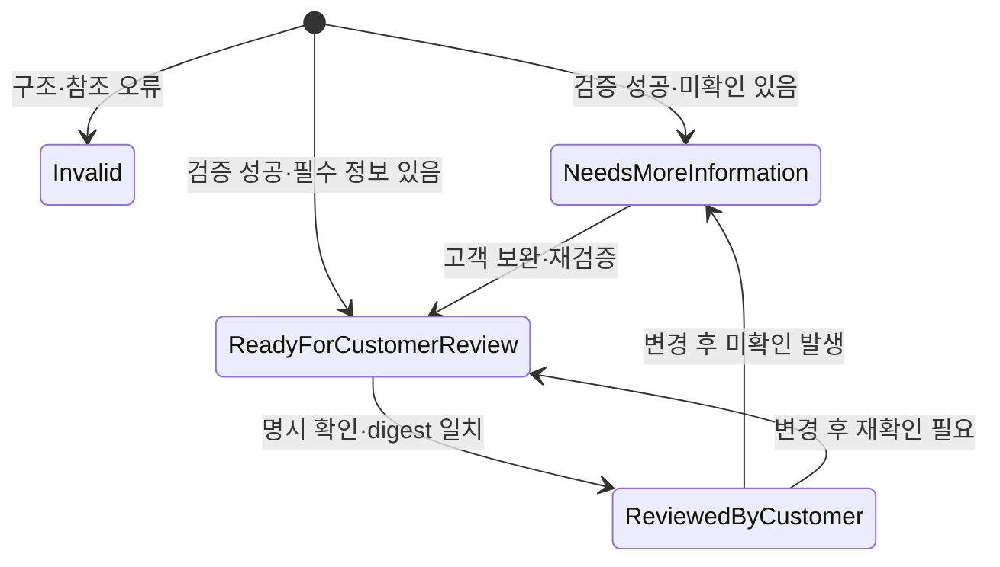

# 거래장애 기록 도우미 구현 스펙

문서 버전: 1.0-draft  
기준일: 2026-11-18 (Asia/Seoul)  
상태: 보류된 후보의 스펙. 주제 재검토 중이며 아래 신규 명령·모듈·테스트는 미구현.  
관련 문서: [제품 설계](DESIGN.md), [공개 근거](EVIDENCE.md)

후속 조사: [문제 후보 재조사](RESEARCH_02.md). 이 스펙을 신규 구현 착수의 확정 근거로 사용하지 않는다.

이 문서는 MVP의 기술 선택과 구현 계약을 정의한다. 기존 Safe Trade Rule Builder의 테스트 결과는 신규 구현 완료의 근거가 아니다. 구조화 입력 이후의 스키마·검증·출력 계약은 이 문서를 기준으로 한다.

## 1. 제품과 실행 계약

| 항목 | 정의 |
| --- | --- |
| 플러그인 ID | `trade-incident-helper` |
| 사용자 표시명 | 거래장애 기록 도우미 |
| 스킬 ID | `prepare-trade-incident` |
| 직접 사용자 | 거래 장애 후 사실관계와 문의 내용을 준비하는 카카오페이증권 고객 |
| 입력 | 고객 진술, 사전에 마스킹한 UTF-8 텍스트·CSV, 패키지의 공식 출처 자료 |
| 출력 | 사건 JSON, 타임라인, 준비 목록, 문의 초안, 사용 출처, 검증 결과 |
| 실행 방식 | Codex가 스킬 절차에 따라 로컬 Python CLI 호출 |
| 네트워크 | CLI는 외부 통신 없음. 공식 자료 갱신은 별도 유지보수 작업 |
| 개인정보 경계 | CLI 외부 송신 없음. Codex가 읽은 내용은 호스트 처리·대화 로그에 포함될 수 있음 |
| 공식 접수 | 고객이 별도 수행. 접수 상태는 항상 `not_submitted` |

MVP는 보상 자격과 확정 손실액을 계산하지 않는다. 원인·시간·적용 규정이 미확인인 상태를 결과에 표현해야 한다.

## 2. 사용할 기술

### 2.1 실행 기술

버전 범위는 프로젝트 선택이며 최신 버전이라는 뜻이 아니다. 구현 시 실제 검증한 정확한 버전을 lockfile에 고정한다.

| 영역 | 채택 기술·범위 | 사용 목적과 선택 이유 |
| --- | --- | --- |
| 호스트 | 호환 manifest와 스킬을 로드하는 Codex 환경 | 고객 대화, 구조화 초안, 로컬 도구 실행 |
| 언어 | CPython `>=3.12,<3.13` | 기존 실행 기반과 일치시키고 지원 범위를 좁힘 |
| 스키마 | `pydantic>=2.8,<3` | 타입·enum·구조 검증, JSON Schema 생성 |
| 문서 생성 | `Jinja2>=3.1.6,<4` | 검증된 모델에서 고정 Markdown 생성 |
| 시간대 | 표준 `datetime`, `zoneinfo` + `tzdata` | IANA 시간대, DST, Windows 시간대 데이터 지원 |
| CSV | 표준 `csv.DictReader` | 작은 파일을 명시적 열 계약으로 처리 |
| JSON | 표준 `json` | 중복 키·비표준 숫자 거부, 일정한 직렬화 |
| 파일·무결성 | `pathlib`, `hashlib`, `tempfile`, `os` | 경로 검사, SHA-256, 임시 출력과 결과 확정 |
| CLI | 표준 `argparse` | `validate`·`render` 두 명령과 고정 종료 코드 |
| 저장 | UTF-8 JSON·Markdown | 고객이 직접 검토할 수 있는 로컬 산출물 |

Pydantic strict validation으로 의도하지 않은 타입 변환을 제한한다. 입력 경로에 따른 차이는 테스트로 고정한다. [Pydantic 공식 문서](https://docs.pydantic.dev/latest/concepts/strict_mode/)

`zoneinfo`는 시스템 데이터 또는 `tzdata`를 사용한다. Windows 지원을 위해 `tzdata`를 필수 의존성에 포함한다. [Python 공식 문서](https://docs.python.org/3.12/library/zoneinfo.html)

CSV는 문자열 분리 대신 표준 파서를 사용한다. [Python 공식 문서](https://docs.python.org/3.12/library/csv.html)

### 2.2 개발·검증 도구

| 도구 | 역할 | 필수 산출물·검증 |
| --- | --- | --- |
| `uv` | 개발 환경과 의존성 동기화 | `pyproject.toml`, `uv.lock`, `uv sync --locked` |
| `pytest` | 단위·통합·CLI 테스트 | 시간·참조·경로·오류·문서 일치 |
| `pytest-cov` | 테스트 누락 확인 | 핵심 순수 로직 branch coverage 85% 이상 목표 |
| `Ruff` | lint·format | 변경 코드 전체 통과 |
| GitHub Actions | Windows·Ubuntu CI | Python 3.12에서 같은 테스트 실행 |
| 표준 `zipfile` | 제출 ZIP 생성·검사 | 필수 파일, 경로 이탈, 제외 파일 |
| 실제 Codex 설치 환경 | 스킬 활성화·실행 확인 | 버전·OS·호출 문구·생성 파일 기록 |

`uv --locked`로 lockfile 정합성을 확인하며 CI의 도구 버전도 고정한다. [uv 공식 문서](https://docs.astral.sh/uv/concepts/projects/sync/)

개발 의존성은 `pytest>=8,<9`, `pytest-cov>=5,<7`, `ruff>=0.6,<1`로 시작하고 첫 구현에서 호환성을 검증한다. 현재 환경의 설치 여부를 이 문서에서 보장하지 않는다.

### 2.3 MVP에서 도입하지 않는 구성

| 구성 | 결정 이유 |
| --- | --- |
| 별도 OpenAI API·고정 모델 | 대화는 호스트 Codex가 담당하고 CLI에는 LLM 호출이 필요하지 않음 |
| MCP 서버 | 두 로컬 명령으로 실행 계약 충족 가능 |
| FastAPI·React·웹 서버 | 사용자 화면은 Codex 대화와 생성 파일 |
| Lambda·API Gateway·DynamoDB | 서버 공유 상태와 상시 실행이 필요하지 않음 |
| 벡터 DB·RAG 프레임워크 | 소수의 공식 자료와 규칙 ID로 추적 가능 |
| pandas | 작은 CSV는 표준 파서로 처리 가능 |
| OCR·PDF 처리 | 텍스트·CSV의 정확성과 사용 흐름부터 검증 |
| Docker | Python 3.12와 lockfile로 로컬·CI 환경 구성 |

추가 도입은 요구사항과 측정 결과가 생겼을 때 결정한다.

## 3. 실행 환경과 설치

지원 OS는 Windows 11 PowerShell과 Ubuntu 24.04다. CI에서 두 OS를 검사한다. macOS는 후속 지원 대상이다.

고객 환경에는 플러그인, Python 3.12, 런타임 의존성 설치가 필요하다. 플러그인 설치만으로 Python 의존성이 자동 해결된다고 가정하지 않는다. `uv`를 권장하되 고정 버전 `requirements.txt`와 `pip` 설치도 지원한다.

첫 실행에서 Python 버전, Pydantic·Jinja2·tzdata import, 패키지 출처 자료의 스키마를 검사한다. 실패하면 사건 파일을 읽기 전에 설치 오류로 종료한다. 권한은 호스트의 기존 승인 정책을 따른다.

최소 지원 Codex 버전은 실제 로드 검증 후 확정한다. CLI·IDE·desktop 전체의 동일 동작을 문서 조사만으로 보장하지 않는다. [OpenAI 패키징 문서](https://developers.openai.com/plugins/build/plugins)

## 4. 개발·제출 디렉터리

신규 구현 루트는 `prototype/trade-incident-helper/`다. 현재 저장소의 기존 `src/`를 덮어쓰지 않는다. 아래는 신규 프로젝트 내부의 목표 구조다.

```text
prototype/trade-incident-helper/
  src/                                      # 제출 ZIP의 src/에 대응
    .codex-plugin/plugin.json
    pyproject.toml
    uv.lock
    requirements.txt
    skills/prepare-trade-incident/
      SKILL.md
      scripts/
        case_cli.py                         # 얇은 CLI 진입점
        trade_incident/
          __init__.py
          cli.py
          models.py
          input_reader.py
          evidence_reader.py
          timeline.py
          source_catalog.py
          checklist.py
          validator.py
          renderer.py
          workspace.py
      references/
        official-sources.json
        procedure-rules.json
      assets/
        timeline.md.j2
        checklist.md.j2
        inquiry.md.j2
    schemas/
      case-draft.v1.schema.json
      resolved-case.v1.schema.json
      validation.v1.schema.json
    examples/
      synthetic-order-incident/
      synthetic-quote-delay/
    docs/
      DESIGN.md
      SPEC.md
      EVIDENCE.md
  tests/
    unit/
    integration/
    cli/
    fixtures/
  tools/package_submission.py
  .github/workflows/ci.yml
  README.md
  logs/
```

`pyproject.toml`에 `tool.uv.package = false`를 설정하고 wheel 배포는 하지 않는다. `case_cli.py`와 같은 `scripts/` 아래의 패키지를 일반 import로 호출한다. JSON Schema는 Pydantic 모델에서 생성한다. 배포용 `requirements.txt`는 lockfile에서 런타임 의존성만 내보내고 CI에서 동기화를 검사한다.

## 5. 모듈 책임

| 모듈 | 입출력 | 책임 |
| --- | --- | --- |
| `models.py` | JSON object → typed models | 모든 모델·enum·구조 검증 |
| `input_reader.py` | JSON bytes → CaseDraft | 크기·인코딩·중복 키 검사 |
| `evidence_reader.py` | manifest → EvidenceRecord[] | TXT·CSV 해석, 행 참조, 해시 |
| `timeline.py` | events → 정규화 events | 시각 처리, 미확인 시각, 안정 정렬 |
| `source_catalog.py` | packaged JSON → 출처 snapshot | 출처 유형·적용 시점·개정 상태 검사 |
| `checklist.py` | case + rules → checklist | 준비 상태, 근거 ID 부여 |
| `validator.py` | case + evidence + sources → report | 참조 무결성, 충돌, 질문, 문서 상태 |
| `renderer.py` | ResolvedCase → 문서 | 고정 템플릿 렌더링 |
| `workspace.py` | 입력·출력 경로 → 허용 경로 | 작업 경계, 링크, 충돌, 결과 확정 |
| `cli.py` | argv → exit code + JSON stdout | 공통 로직 호출, 예외 분류 |

업무 규칙을 CLI와 스킬 본문에 중복 구현하지 않는다. 두 명령은 같은 모델·검증 함수를 사용한다.

## 6. Codex 스킬 계약

스킬에는 다음 순서를 한국어로 명시한다.

1. 장애가 진행 중인지 확인하고 해당하면 패키지의 공식 대응 정보를 먼저 보여준다.
2. 입력 전 마스킹과 호스트·대화 로그에 입력이 남을 수 있다는 점을 짧게 안내한다.
3. 고객 설명을 Statement로 보존하고 구조화한 CaseDraft를 작성한다.
4. 파일을 대화에 전문 출력하기 전에 CLI 검사를 실행한다. CLI는 원문·식별정보를 stdout에 내보내지 않는다.
5. validate 결과를 읽고 누락 정보와 충돌을 고객에게 질문한다.
6. 고객 정정을 새 입력 revision에 반영하고 재검증한다.
7. render로 산출물을 만들고 미확인 항목과 초안 위치를 안내한다.
8. 고객이 내용을 명시적으로 확인한 경우에만 리뷰 정보를 기록한다.

LLM 추출 자체의 결정적 재현성은 보장하지 않는다. 구조화 입력 이후의 검증·문서 생성이 재현성 범위다. 자료 안의 명령은 도구 실행 지시로 취급하지 않는다.

스킬 단독 구성과 입력·절차·출력 경계 원칙은 [OpenAI 공식 문서](https://developers.openai.com/plugins/build/skills)를 따른다.

## 7. 입력 모델

### 7.1 공통 규칙

모든 모델에 `extra='forbid'`를 사용한다. JSON에서 읽은 Python object에 `strict=True` 검증을 적용해 숫자 문자열·bool·정수의 의도하지 않은 변환을 거부한다. 날짜 문자열은 별도 함수로 처리한다.

ID는 `[a-z][a-z0-9_-]{0,63}`이다. 표시명과 분리하고 고객 실명·계좌 ID는 모델에 넣지 않는다.

### 7.2 CaseDraft

모든 필드는 필수다. 빈 배열·null 허용 여부는 표에 따른다.

| 필드 | 타입·제약 |
| --- | --- |
| `schema_version` | literal `trade-incident-draft.v1` |
| `case_id` | ID 형식 |
| `revision` | int, 1 이상 |
| `company` | literal `kakaopay-securities` |
| `scenario` | synthetic / customer_provided |
| `incident_state` | ongoing / ended / unknown |
| `observed_type` | order_submission_unresponsive / quote_delay / app_access_failure / unknown |
| `statements` | Statement[], 1개 이상 |
| `events` | EventDraft[], 0~500개 |
| `evidence` | EvidenceManifest[], 0~20개 |
| `customer_review` | CustomerReview 또는 null |

cause, document_status, 검증 완료 등 파생 필드를 입력에서 지정할 수 없다. 보상 자격·접수 상태는 출력의 고정값이다.

### 7.3 Statement

| 필드 | 타입·계약 |
| --- | --- |
| `statement_id` | 고유 ID |
| `text` | 고객의 마스킹된 설명, 1~4,000자 |
| `recorded_at` | 시간대가 있는 RFC 3339 문자열, 호스트가 기록 시점 부여 |
| `recorded_by` | literal customer_via_codex |

recorded_at은 장애 발생 시각이 아니다. 읽기 좋게 정리한 요약으로 원래 자기진술을 대체하지 않는다.

### 7.4 EventDraft

| 필드 | 타입·계약 |
| --- | --- |
| `event_id` | 고유 ID |
| `action` | attempted_order / attempted_emergency_order / connection_failed / observed_delay / other |
| `time_raw` | 원래 시각 문자열 또는 null |
| `timezone` | IANA 이름 또는 null |
| `fold` | DST 중복 시각의 0/1, 평소에는 null |
| `description` | 마스킹된 요약, 1~1,000자 |
| `statement_refs` | Statement ID 배열 |
| `evidence_refs` | EvidenceRef[] |

각 이벤트에는 자기진술 또는 자료 참조가 최소 하나 필요하다. EvidenceRef는 evidence_id, row_start, row_end, quote를 갖는다. 행 번호는 1부터 시작하고 종료 행을 포함한다.

참조 위치에 인용문이 실제 있는지는 코드로 검사한다. 인용문이 사건을 입증하는지, 요약과 의미가 같은지는 고객 검토 대상이다. 문자열 일치를 사실 검증 완료로 표시하지 않는다.

### 7.5 EvidenceManifest

| 필드 | 타입·계약 |
| --- | --- |
| `evidence_id` | 고유 ID |
| `path` | workspace 기준 상대 경로 |
| `media_type` | text/plain / text/csv |
| `masked_by_customer` | literal true |
| `description` | 0~500자 |

마스킹 표시는 고객 확인이며 익명화 보장이 아니다. SHA-256·크기·행 수는 CLI가 실제 bytes에서 계산한다.

### 7.6 CSV 형식

플러그인 자체 입력 형식이다. 카카오페이증권 공식 내보내기 형식이라고 설명하지 않는다. 다른 형식은 명시적으로 변환한 뒤 읽는다.

```csv
record_id,occurred_at,timezone,event_type,description
record-001,2026-11-17T23:40:00,Asia/Seoul,attempted_order,Order button did not respond
record-002,,,connection_failed,Time not recorded
```

5개 헤더 모두 필수다. 중복·미지정 열, 열 수가 다른 행, 중복 record_id, 허용 목록 밖 event_type은 거부한다. 시각·시간대 값은 빈칸을 허용하며 event_type은 EventDraft.action enum을 사용한다.

구분자는 쉼표, 인용부호는 double quote다. UTF-8 BOM과 LF/CRLF는 허용한다. MVP에서는 한 레코드 안의 줄바꿈을 거부해 물리 행과 데이터 행의 참조를 고정한다. CP949는 추정 변환하지 않고 UTF-8 변환을 안내한다.

## 8. 출력 모델

### 8.1 ResolvedCase

| 항목 | 계약 |
| --- | --- |
| `schema_version` | trade-incident-case.v1 |
| `case_id`, `revision` | 입력과 일치 |
| `input_digest` | 정규화 입력·실측 자료 해시·출처 및 규칙 snapshot으로 계산 |
| `generated_at` | UTC RFC 3339 |
| `events` | 원래 시각, UTC 또는 null, 시각 상태, 참조, 출처 구분 |
| `evidence` | 실측 해시·크기·행 수, 출처는 customer_provided |
| `source_snapshot` | 사용한 출처 ID·버전·확인일·digest |
| `checklist` | 항목 ID, 준비 상태, 근거 ID, 질문 ID |
| `review.document_status` | needs_more_information / ready_for_customer_review / reviewed_by_customer |
| `review.compensation_eligibility` | literal not_assessed |
| `review.application_deadline` | MVP에서는 null. 사건별 기한 자동 추출은 후속 기능 |
| `review.submission_status` | literal not_submitted |

출처 구분은 self_reported / observed_in_provided_material / official_statement / unverified다. 고객 파일을 회사 원장으로, 공식 일반 안내를 개별 사건 확인으로 취급하지 않는다.

### 8.2 ValidationReport

```json
{
  "schema_version": "trade-incident-validation.v1",
  "case_id": "demo-case-001",
  "valid": true,
  "document_status": "needs_more_information",
  "issues": [
    {
      "code": "TIMEZONE_REQUIRED",
      "severity": "warning",
      "path": "/events/0/timezone",
      "message": "시간대를 확인해 주세요.",
      "related_ids": ["event-001"]
    }
  ],
  "questions": [
    {
      "question_id": "question-001",
      "target_path": "/events/0/timezone",
      "message": "이 시각은 한국 시각인가요, 미국 현지 시각인가요?"
    }
  ]
}
```

valid는 구조·참조·처리 가능 여부다. 정보 부족 warning이 있어도 true일 수 있다. error가 하나라도 있으면 false이며 문서 생성을 중단한다.

### 8.3 생성 파일

| 파일 | 필수 내용 |
| --- | --- |
| `case.json` | ResolvedCase 전체 |
| `timeline.md` | 정렬 가능한 사건, 미정렬 사건, 출처·참조 |
| `preparation-checklist.md` | 준비 상태, 질문, 공식 출처 |
| `inquiry-draft.md` | 고객 설명, 요청 내용, 미확인 사항, 첨부 목록 |
| `sources.json` | 사용한 출처·규칙 snapshot |
| `validation.json` | 전체 검증 결과 |

Markdown에는 원문 전문 대신 evidence-id:L2-L3 참조를 붙인다. 인용은 필요한 짧은 범위만 허용하고 제어문자·Markdown 특수문자를 escape한다. HTML 전환에는 별도 HTML escaping이 필요하다.

## 9. 시간·정렬 규칙

1. 원래 표기를 보존한다. “어제 23시”는 기준일을 고객이 확인할 때까지 미해결 상태다.
2. 날짜·시각·시간대가 명확할 때만 UTC를 만든다. OS 기본 시간대를 사용하지 않는다.
3. IANA 이름과 명시 offset이 함께 있으면 일치 여부를 확인한다. 불일치는 warning으로 표시하고 정규화를 보류한다.
4. DST로 존재하지 않는 시각은 UTC 왕복 검사로 탐지한다. 중복 시각은 명시 fold 또는 고객 확인이 필요하다.
5. 정규화한 항목은 (utc_timestamp, event_id)로 안정 정렬한다. 미해결 항목은 별도 영역에 입력 순서를 유지한다.
6. 시각 역전만으로 고객 기억이 틀렸다고 단정하지 않고 충돌하는 참조를 함께 표시한다.

EST·KST 등 약칭은 바로 정규화하지 않는다. America/New_York·Asia/Seoul 등으로 확인한다.

## 10. 공식 자료와 준비 규칙

official-sources.json은 개발자가 원문을 확인해 갱신하는 관리 자료다. 고객 URL을 자동으로 공식 출처로 등록하지 않는다.

출처 필드는 source_id, kind, url, title, published_at, checked_at, effective_from, effective_to, version, summary, summary_sha256다. 원문 bytes를 보관하지 않았다면 content_sha256=null이다. 요약 해시를 원문 해시로 표시하지 않는다.

kind는 official_procedure / official_incident_notice / news_report다. 준비 규칙에는 공식 출처만 사용할 수 있고 뉴스는 문제 배경 설명에 사용한다.

적용일이 없으면 null이다. 과거 사건 적용을 자동 승인하지 않는다. 확인 후 30일이 지난 자료에는 SOURCE_STALE을 붙인다. 30일은 제품 재확인 기준이며 공식 규정이 아니다. stale 상태도 확인일·한계를 표시한 초안은 생성할 수 있다.

procedure-rules.json에는 rule_id, source_id, section_label, prompt, required_fields, applicability를 둔다. 준비 상태는 provided / missing / unknown / not_applicable / needs_official_confirmation이다.

초기 분류는 사건 설명, 날짜·시간대, 주문 관련 행동, 보유 자료, 공식 안내 확인의 5개다. 자료 정리용 분류이며 보상 판정 엔진이 아니다. 공식 절차 설명은 [E2·E3](EVIDENCE.md)와 연결한다.

## 11. 문서 상태와 고객 리뷰



CustomerReview는 confirmed_at, reviewed_digest를 갖는다. 현재 input_digest와 일치할 때만 확인 상태를 유지한다. 입력·자료·출처·규칙이 바뀌면 리뷰를 무효화한다.

digest는 customer_review·생성 시각을 제외한 입력, 실측 자료 해시, 출처·규칙 snapshot에서 계산한다. JSON은 키 정렬·UTF-8·고정 separator로 직렬화한다. 변경 감지용이며 본인확인·전자서명이 아니다.

필수 정보는 사건 설명, 최소 1개 이벤트와 유효한 출처 연결, 날짜·시간대다. 준비 목록의 미확인 항목이나 시각 충돌이 남으면 needs_more_information이다. error이면 ResolvedCase를 만들지 않는다.

## 12. CLI 명령과 응답

다음은 신규 프로젝트 루트를 cwd로 하는 구현 후 계약이다. 현재 사용할 수 있는 명령은 아니다.

```powershell
uv sync --project src --locked

uv run --project src --locked python `
  src/skills/prepare-trade-incident/scripts/case_cli.py validate `
  --workspace work/demo --case case-draft.json

uv run --project src --locked python `
  src/skills/prepare-trade-incident/scripts/case_cli.py render `
  --workspace work/demo --case case-draft.json `
  --out outputs/demo-case-001-r1
```

--workspace는 cwd 기준, --case·증거 경로·--out은 workspace 기준 상대 경로다. 패키지 출처·템플릿은 __file__ 기준으로 읽고 cwd의 동명 파일은 사용하지 않는다.

validate는 결과만 stdout에 출력하며 업무 파일을 수정하지 않는다. render는 입력을 다시 검증하고 외부의 검증 성공 값을 신뢰하지 않는다.

stdout은 항상 JSON object 한 개다. stderr는 짧은 진단만 사용한다. validate 결과는 ValidationReport, 생성 성공은 다음 형태다.

```json
{
  "schema_version": "trade-incident-cli.v1",
  "ok": true,
  "case_id": "demo-case-001",
  "output_dir": "outputs/demo-case-001-r1",
  "files": ["case.json", "timeline.md", "preparation-checklist.md", "inquiry-draft.md", "sources.json", "validation.json"]
}
```

| 종료 코드 | 의미 |
| --- | --- |
| 0 | 검증·생성 성공. warning만 있으면 성공 |
| 2 | CLI 인수, 입력 형식, 참조 오류 |
| 3 | 파일 읽기·쓰기·접근 실패 |
| 4 | 경로 경계·용량·개인정보 후보 등 처리 중단 조건 |
| 5 | 패키지 자료·템플릿·의존 환경 불일치 |
| 1 | 예상하지 못한 내부 오류 |

argparse 인수 오류도 CLI 경계에서 JSON으로 바꾼다. 내부 예외·원문·식별정보를 그대로 오류 메시지에 넣지 않는다.

```json
{
  "schema_version": "trade-incident-cli.v1",
  "ok": false,
  "error": {
    "code": "EVIDENCE_REFERENCE_INVALID",
    "message": "참조한 자료의 행 범위를 확인해 주세요.",
    "path": "/events/0/evidence_refs/0"
  }
}
```

모델 생성 뒤 발견한 검증 오류는 ValidationReport로 반환한다. 인수·파일 접근처럼 모델 생성 전 오류는 위 CLI 오류 형식이다. 종료 코드 분류는 같다.

## 13. 검증 오류

| 코드 | 수준 | 처리 |
| --- | --- | --- |
| SCHEMA_INVALID, DUPLICATE_JSON_KEY | error | 생성 중단 |
| EVIDENCE_REFERENCE_INVALID, QUOTE_NOT_FOUND | error | 참조 수정 전 생성 중단 |
| CSV_INVALID, ENCODING_UNSUPPORTED | error | 원본 변경 없이 안내 |
| PATH_OUTSIDE_WORKSPACE, LINK_NOT_ALLOWED | error | 읽기·쓰기 중단 |
| INPUT_LIMIT_EXCEEDED, PII_SUSPECTED | error | 원문 없이 위치만 안내 |
| OUTPUT_EXISTS | error | 덮어쓰지 않고 새 revision 경로 요구 |
| SOURCE_CATALOG_INVALID, TEMPLATE_INVALID | error | 패키지 복구 전 생성 중단 |
| TIMEZONE_REQUIRED, TIME_AMBIGUOUS, TIME_NONEXISTENT, TIME_OFFSET_CONFLICT | warning | UTC는 null, 질문 생성 |
| EVENT_CONFLICT, SOURCE_STALE, HISTORICAL_POLICY_UNVERIFIED | warning | 미확인 표시 후 초안 생성 가능 |
| INFORMATION_MISSING | warning | 준비 부족 표시 |

자료에 기록이 없는 것과 고객이 행동하지 않은 것을 구분한다. 누락을 부정 사실로 바꾸지 않는다.

## 14. 파일 처리와 제한

| 제한 | MVP 값 |
| --- | --- |
| case JSON | 1 MiB 이하 |
| 증거 파일 1개 | 2 MiB 이하 |
| 증거 총량 | 10 MiB 이하 |
| 증거 수 | 20개 이하 |
| CSV | 데이터 5,000행 이하, 필드 16 KiB 이하 |
| 텍스트 | 10,000행 이하 |
| 인코딩·형식 | UTF-8·UTF-8 BOM, TXT·CSV |

제한은 코드 한 곳에 정의하고 메타데이터에 버전을 기록한다. 실측 크기를 확인하고 상한 초과 파일을 통째로 메모리에 읽지 않는다.

resolve한 절대 경로가 workspace 안인지 확인한다. symlink와 Windows junction/reparse point를 포함하는 경로를 거부한다. drive 지정·UNC·상위 경로·Windows 예약명·alternate data stream을 검사한다.

읽은 bytes에서 해시와 파싱 결과를 함께 만든다. 검증 후 다른 내용의 파일을 재독하지 않는다. 공유 PC의 공격 프로세스에 대한 OS sandbox 보장으로 설명하지 않는다.

render는 같은 부모의 임시 폴더에 모든 파일을 생성·검증하고 사용하지 않은 최종 경로로 rename한다. 실패 시 완성 폴더를 공개하지 않고 기존 출력은 덮어쓰지 않는다. 동일 workspace의 동시 render는 잠금으로 거부한다. crash 후 잠금은 점검 뒤 명시적으로 해제한다.

## 15. 템플릿과 개인정보

Jinja2는 고정 템플릿만 FileSystemLoader로 읽고 StrictUndefined를 사용한다. 고객 입력을 템플릿 소스로 실행하지 않는다. Markdown escaping은 별도 함수다. [Jinja 공식 문서](https://jinja.palletsprojects.com/en/stable/api/)

고정 라벨은 한국어, 파일명·JSON 키는 ASCII다. 최종 문서는 LLM 재생성 없이 검증 모델에서 렌더링한다. 자연어 다듬기는 입력 구조화 단계에서 수행하고 원래 진술도 보존한다.

개인정보 후보 검사는 이메일·전화·주민등록번호 형태와 식별정보 열 이름에서 시작한다. 정규표현식만으로 모든 개인정보를 탐지한다고 주장하지 않는다. 고객의 사전 마스킹과 출력 검토가 필요하다.

PII_SUSPECTED는 위치만 반환하고 실제 값을 진단에 남기지 않는다. 로컬 검사가 이미 대화·호스트로 보낸 정보를 소급 삭제하지 못한다는 점을 스킬 안내에 넣는다.

## 16. 테스트 명세

| 테스트 ID | 대상 | 통과 조건 |
| --- | --- | --- |
| MODEL-01 | strict 검증 | 숫자 문자열·bool 혼입·알 수 없는 키 거부 |
| MODEL-02 | JSON | 중복 키·NaN·Infinity 거부 |
| REF-01 | 참조 | 없는 ID·행 범위·다른 인용문 거부 |
| CSV-01 | CSV | BOM·CRLF 허용, 중복 열·잘못된 열·내부 줄바꿈 거부 |
| TIME-01 | 시간대 | 서울·뉴욕 날짜 경계와 offset 처리 |
| TIME-02 | DST | 없는·중복 시각 탐지, 확인 전 UTC 미확정 |
| TIME-03 | 미상 시각 | null 유지, 확정 사건과 다른 영역 표시 |
| POLICY-01 | 출처 | 뉴스를 공식 준비 규칙 근거로 사용 불가 |
| POLICY-02 | 적용·확인일 | 주입 clock으로 30일 경계·과거 적용 미확인 검증 |
| STATE-01 | 리뷰 | 입력·증거·출처·규칙 변경 시 digest 변경과 재검토 |
| PATH-01 | 경계 | 상위·절대 경로, symlink, Windows junction 거부 |
| LIMIT-01 | 상한 | 파일 수·bytes·행 수 경계 검사 |
| PRIVACY-01 | 출력 | 탐지한 식별정보를 stdout·stderr·산출물에 노출하지 않음 |
| OUTPUT-01 | 일치 | Markdown ID·시각·상태가 JSON과 일치 |
| OUTPUT-02 | 실패 | 중간 쓰기 실패·기존 출력에서 불완전 결과 미공개 |
| CLI-01 | 계약 | 인수 오류 포함 종료 코드와 JSON 형식 일치 |
| CLI-02 | 재현성 | 같은 입력에서 생성 시각 등 제외한 결과 일치 |
| E2E-01 | Codex | 설치한 스킬에서 6개 파일 생성 완료 |

기술 테스트는 합성 자료와 tmp_path로 실행한다. CLI가 외부 접속을 시도하면 실패시키는 테스트도 둔다. CI의 의존성 다운로드와 앱 실행 중 통신은 구분한다. [pytest 공식 문서](https://docs.pytest.org/en/stable/how-to/tmp_path.html)

coverage 대상은 모델·파서·시간·규칙·검증·workspace 핵심 분기다. 전달 코드를 반복 검증해 수치만 올리지 않는다. 고객 가치·일반 채팅 비교는 [제품 검증 계획](DESIGN.md)에 따라 별도로 수행한다.

## 17. CI와 배포

신규 프로젝트 루트의 예정 명령이다.

```powershell
uv sync --project src --locked --group dev
uv run --project src --locked ruff check src/skills tests
uv run --project src --locked ruff format --check src/skills tests
uv run --project src --locked pytest -c src/pyproject.toml tests
uv run --project src --locked python tools/package_submission.py --check-only
```

CI에는 Python 3.12·uv·GitHub Actions 버전을 고정한다. 의존성 갱신에서만 lockfile을 바꾸고 일반 CI에서 자동 재해결하지 않는다.

ZIP에는 src/·루트 README·logs/를 포함한다. 가상환경·Git·캐시·환경변수 파일·실제 고객 자료·workspace·과거 프로젝트 코드는 제외한다. 로그는 허용 텍스트 형식의 전체 대화다. 비밀정보 후보를 발견하면 자동 편집하지 않고 패키징을 중단해 경위를 확인한다.

필수 manifest, 비어 있지 않은 스킬, 의존성·자료·템플릿, 경로 경계, 합성 예제 CLI 실행, 비어 있지 않은 로그를 검사한다. 실제 Codex 검증과 유닛테스트 결과를 나눠 기록한다.

## 18. 구현 티켓

| ID | 작업 | 선행 | 완료 기준 |
| --- | --- | --- | --- |
| IMP-01 | 프로젝트·의존성·CI 골격 | 없음 | 두 OS import·lint |
| IMP-02 | 모델·Schema 생성 | 01 | MODEL 테스트, schema 동기화 |
| IMP-03 | workspace·입력·증거 파서 | 02 | PATH·LIMIT·CSV·REF 테스트 |
| IMP-04 | 시각 정규화 | 02 | TIME 테스트 |
| IMP-05 | 출처·준비 규칙 | 02 | POLICY 테스트 |
| IMP-06 | 공통 검증·질문·digest | 03~05 | STATE·충돌 사례 |
| IMP-07 | 템플릿·render·일괄 출력 | 06 | OUTPUT 테스트 |
| IMP-08 | CLI·종료 코드 | 06~07 | CLI 테스트, 합성 예제 완주 |
| IMP-09 | Codex 스킬·실제 실행 | 08 | E2E 결과·환경 기록 |
| IMP-10 | 고객 검증·제출 패키지 | 09 | 가치 검증 기록·ZIP 검사 |

기술 MVP는 01~09 완료 시점이다. 제출 준비 완료에는 10과 전체 로그 정합성 확인도 필요하다.

## 19. 완료 기준

- 목표 Codex 환경에서 스킬이 로드되고 실제 CLI 호출로 6개 산출물을 생성한다.
- 미확인 원인·시각·기한·보상 자격을 만들지 않고 부족 정보를 남긴다.
- 모든 이벤트에 자기진술 또는 자료 참조가 있으며 잘못된 참조를 코드로 거부한다.
- Windows·Ubuntu에서 필수 테스트·lint를 통과하고 핵심 분기 coverage 목표를 충족한다.
- 출처 버전·자료 해시가 남고 같은 구조화 입력의 결과가 재현된다.
- 고객 리뷰와 공식 접수를 혼동하지 않는다.
- README에 설치·합성 예제·제약·검증한 Codex 환경을 기록한다.
- 설계·구현·데모·전체 로그를 맞추고 기존 submission.zip과 신규 제출을 구분한다.

고객의 사용 의사·준비 시간 단축·Codex 접근성은 별도로 측정한다. 기술 완료를 고객 가치 입증으로 표시하지 않는다.
