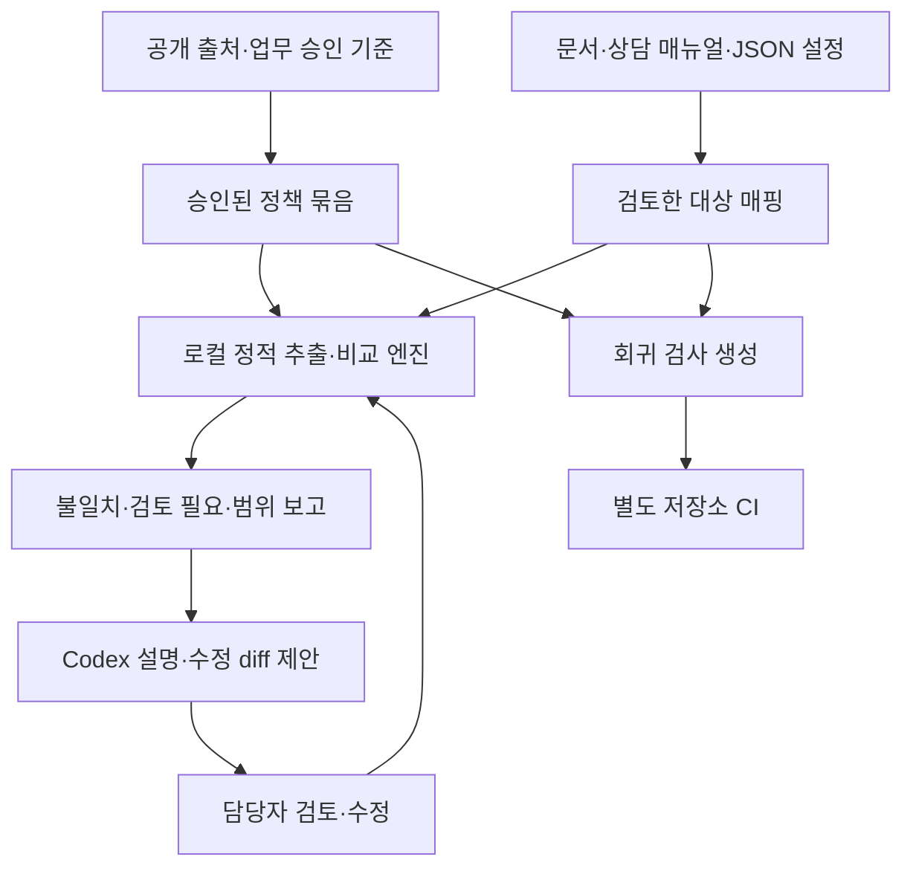

# 증권 정책 정합성 검증기 설계

문서 버전: 2.0-draft  
기준일: 2026-11-18 (Asia/Seoul)  
패키지: `securities-rule-guard`  
상태: 엔터프라이즈 방향으로 재선정한 제안 설계. 신규 기능 미구현.  
관련 문서: [공개 근거](EVIDENCE.md), [구현 스펙](SPEC.md)  
이전 설계: [고객용 장애 기록 도우미 이력](archive/customer-incident/DESIGN.md)

## 1. 한 문장 주제

**카카오페이증권의 개발·QA·상담 지식관리 담당자가 승인된 신용거래 기준과 안내문·상담 매뉴얼·설정의 불일치를 찾아 수정하고, 같은 오류를 다시 검사할 수 있게 만드는 Codex 플러그인.**

가칭은 “증권 정책 정합성 검증기”다. 업무 완료의 단위는 **검수 대상별 불일치 위치와 근거를 확인하고, 수정 뒤 동일 검사를 통과하는 것**이다.

“금융 규정을 설명하는 챗봇”이나 “사고 보고서를 대신 쓰는 도구”가 아니라, 저장소의 업무 산출물을 읽고 검증 결과·회귀 검사를 만드는 작업 도구로 설계한다.

## 2. 과제 적합성

과제는 선택한 기업, 그 기업의 산업 또는 고객이 겪는 공개·검증 가능한 문제를 대상으로 한다. 기업 내부 담당자를 직접 사용자로 삼을 수 있다.

| 과제 요소 | 이번 설계 |
| --- | --- |
| 기업 | 카카오페이증권 한 곳 |
| 공개 문제 | 고객에게 중요한 금융 조건이 잘못 안내된 사례 |
| 직접 사용자 | QA·상담 지식관리 담당자, 검수 자동화를 연결하는 개발자 |
| 해결 작업 | 승인 기준과 검수 대상 사이 조건 불일치 탐지·수정 확인 |
| Codex 필요성 | 저장소 탐색, 문서·설정 연결, 테스트 파일 생성, 수정 후 재검증 |
| 시연 데이터 | 공개 근거 + 명시적으로 합성한 문서·설정 저장소 |
| 제출 | 실행 가능한 스킬·검증 코드, README, 전체 AI 대화 로그 |

선택 기업의 자회사 범위와 대회 제출 기준일은 [근거 문서](EVIDENCE.md)의 미확인 항목이다.

## 3. 왜 이 문제인가

공개 보도에는 담보비율 오안내와 회사의 오류 인정이 담겨 있다. 회사는 고객이 주장한 전체 처분 규모와 직접 관련 범위는 다르게 설명했다. 사고 전체를 단일 원인·확정 손해로 표현하지 않는다. [사건 근거 B1·B2](EVIDENCE.md)

공식 안내에는 역할이 다른 임계값과 기간·대상별 예외가 공존한다. 따라서 같은 상품에 숫자가 두 개 있다는 이유만으로 오류라고 판단해서는 안 된다. [공식 기준 B3·B4](EVIDENCE.md)

이번 개입은 상담원이 참고하거나 고객에게 배포하기 전의 자료 검수다. 해당 사고가 실제로 문서나 설정 불일치 때문에 발생했다는 뜻은 아니다. 말로만 이루어진 안내, 미등록 문서, 실제 운영 코드의 모든 분기를 이 도구가 검증할 수는 없다.

## 4. 비교한 대안

| 후보 | 판단 이유 |
| --- | --- |
| 정책 안내·설정 정합성 | 실제 오안내와 직접 연결되며 수정 전후 결과가 명확하여 채택 |
| 장애 현황·보고 자동화 | 기업이 핑크와드로 이미 개선했다고 공개해 차별성 부족 |
| 정산 대사 | 계산 작업은 적합하나 공개된 실제 내부 병목의 근거가 부족 |
| 장애 재현 테스트 | 사고 사실만으로 정확한 원인·환경·기대 동작을 재현하기 어려움 |

기업 기술 글에 과거 불편이 있다는 이유만으로 현재도 미해결이라고 주장하지 않는다.

## 5. 사용자와 완료 작업

| 사용자 | 입력·작업 | 받는 결과 |
| --- | --- | --- |
| 정책 소유자·업무 담당자 | 승인할 기준과 조건·적용 시점 확인 | 검수 기준 묶음과 출처 연결 |
| 상담 지식관리·QA | 매뉴얼·고객 안내문을 검사 대상으로 등록 | 잘못된 값·연산자·누락 조건의 파일·행 |
| 개발자 | 설정 위치 매핑, 저장소 검사, 회귀 테스트 연결 | JSON 결과·Markdown 보고서·테스트 초안 |

예시 요청:

> “이 신용거래 안내 변경분을 승인 기준과 비교해줘. 단위나 적용 조건이 불명확한 것은 통과시키지 말고, 수정 뒤 다시 실행할 검사를 만들어줘.”

완료는 출처·기준·검수 범위가 고정된 상태에서 불일치를 찾고 수정 여부를 재확인하는 것이다. 사람의 업무 승인이나 법률 적합성 판단을 대신하지 않는다.

## 6. 핵심 구분: 기준과 관찰

- **승인 기준**: 업무 담당자가 검토한 규칙. 스킬이 자동으로 만들어 승인하지 않는다.
- **관찰 값**: 안내문이나 JSON 설정에서 추출한 값과 조건.
- **검사 결과**: 의미 키·단위·대상·시점을 맞춘 뒤 비교한 결과.
- **검토 필요**: 추출 불가·조건 누락·충돌·등록되지 않은 숫자 문장 등 판정 불가 항목.

기준과 검사 대상이 같은 파일이면 검사하지 않는다. 같은 자료에서 기대값과 관찰 값을 복사해 가짜 통과를 만들지 않는다.

## 7. MVP 범위

최초 도메인은 신용거래의 담보 관련 **명시적 임계값 안내**로 좁힌다.

| 기능 | MVP 동작 |
| --- | --- |
| 기준 등록 | 승인된 JSON 규칙 묶음과 출처 요약 검증 |
| 대상 매핑 | JSON Pointer, Markdown 표식 블록을 규칙 ID에 연결 |
| 정적 추출 | 값·단위·연산자와 검수 문맥 추출 |
| 비교 | 같은 의미·대상·시점의 값과 조건 비교 |
| 변경 영향 | 매핑된 기준 변경 시 영향 받는 파일과 검수 항목 목록 |
| 검수 보고 | 기대/관찰 값, 근거, 파일·행, 미검수 영역 출력 |
| 회귀 검사 생성 | 승인 기준을 고정한 매개변수 테스트와 실행 안내 생성 |
| 수정 검토 | Codex가 제안한 diff를 사람이 확인하고 재검사 |

처음부터 모든 한국어 금융 문장을 자동 해석하지 않는다. 표식이나 검토된 매핑이 없는 문장은 정합성이 확인됐다고 표시하지 않는다.

실주문·자동 반대매매 판단·고객별 담보 계산·법률 준수 인증·사내 DB 조회·외부 문서 자동 게시·PR 자동 병합은 범위 밖이다.

## 8. 동작 예시

아래는 실제 사내 파일이나 사고 당시 매뉴얼이 아닌 **합성 예시**다.

| 자료 | 의미 | 값 |
| --- | --- | --- |
| 승인 기준 | 긴급 상황의 담보 회복 기준 | 140% 이상 |
| 정상 안내 | 같은 조건의 회복 기준 | 140% 이상 |
| 잘못된 상담 문구 | 같은 조건의 회복 기준 | 120% 이상 |
| 별도 조건 안내 | 다른 의미의 발동 임계값 | 120% 미만 |
| 조건 누락 문구 | 언제 적용되는지 알 수 없음 | 130% 이상 |

기대 결과는 정상 안내 통과, 잘못된 문구 불일치, 별도 임계값은 그 규칙으로 비교, 조건 누락은 검토 필요다. 120을 전부 140으로 치환하지 않는다.

한시 예외는 별도 규칙·적용 기간으로 표현한다. 상충하는 공식 설명이 있거나 적용 범위를 확정하지 못하면 담당자에게 판단을 남긴다.

## 9. 사용자 흐름

1. Codex가 공개 출처와 사용자가 제공한 승인 기준을 읽는다.
2. 대상 저장소를 탐색해 검수 후보 파일과 매핑 초안을 제시한다.
3. 담당자가 의미 키·대상·시점·기준·매핑을 검토한다.
4. 로컬 검증 코드가 고정된 입력을 읽어 결과와 커버리지를 계산한다.
5. Codex가 불일치의 위치와 수정 방향을 설명한다.
6. 사용자가 수정 작업을 요청하면 Codex가 diff를 만든다.
7. 같은 기준·검사기로 재검증하고 전후 결과를 남긴다.
8. 회귀 검사를 생성해 저장소 CI에서 반복 실행하도록 연결한다.

기준 승인을 요청해야 하는 시점과 도구 실행 권한은 구분한다. 사용자에게 업무상 기준 승인을 매번 반복 요구하지 않고, 승인한 내용의 digest가 바뀔 때 다시 검토한다.

## 10. 구조



코드가 판정을 담당하고 Codex는 탐색·구조화·설명·수정 작업을 돕는다. MVP에서 별도 LLM API·MCP 서버·AWS 서비스는 필수가 아니다.

## 11. 결과물

```text
ruleguard-output/
  findings.json
  review.md
  coverage.json
  sources.snapshot.json
  inputs.manifest.json
  generated-tests/
    test_policy_consistency.py
    approved_expectations.json
    README.md
```

회귀 테스트는 **자료 정합성 검사**이며 실제 주문 엔진의 행동 검증과 구분한다. 후속 런타임 테스트는 별도 대상 함수·실행 환경·독립 기대값을 갖춰야 한다.

## 12. 검증 목표

| 항목 | 완료 기준 |
| --- | --- |
| 오안내 검출 | 합성된 동일 문맥의 잘못된 임계값·연산자·단위를 모두 탐지 |
| 문맥 구분 | 다른 의미의 120/140, 다른 적용 기간을 잘못된 일치·불일치로 처리하지 않음 |
| 불확실성 | 매핑 누락·추출 실패·정책 충돌을 PASS로 처리하지 않음 |
| 근거 추적 | 모든 불일치에 기준 ID·출처·대상 위치·입력 해시 |
| 회귀 | 수정 전 실패·수정 후 통과, 기준 변경 시 검토 상태 갱신 |
| 사용성 | QA·개발 담당자에게 합성 저장소 검수·수정 완료 과제 수행 |
| 차별성 | 일반 채팅·수작업과 동일 결함 세트를 비교 |
| 효과 | 검수 시간·누락·오탐·초기 매핑 비용을 측정하고 실제 값만 보고 |

사고 감소율·수익 개선·민원 감소를 검증 없이 주장하지 않는다. 검사 대상으로 등록하지 않은 회사 전체 자료를 검수했다고 말하지 않는다.

## 13. 시연

3~5분 시연은 승인 기준 1묶음, 정상·오류·문맥 누락 문서와 설정을 사용한다.

1. 실제 오안내 보도와 회사 반론을 함께 제시한다.
2. 합성 저장소에서 틀린 회복 기준과 잘못된 연산자를 검출한다.
3. 다른 의미의 임계값은 오류로 처리하지 않는 것을 보여준다.
4. Codex가 수정 diff를 제안하고 검토 후 반영한다.
5. 재검사 결과와 생성한 회귀 테스트를 실행한다.
6. 적용 시점이 다른 규칙이나 미등록 문장은 검토 필요로 남는 것을 확인한다.

실제 회사 사고의 재현이라고 부르지 않는다. 공개 문제에서 착안한 검수 시나리오다.

## 14. 남은 확인과 착수 기준

실제 업무 검수에 어떤 자료·승인 절차를 사용하는지, 사내 Codex 접근이 가능한지, 기존 검수 도구와 중복되는지는 미확인이다.

공개 자료·합성 저장소로 MVP 설계와 구현 검증은 가능하다. 기업 실사용 효과는 별도 담당자 평가가 필요하다. 내부 정책 묶음과 등록 가능한 자료가 없다면 범용 자동 검수라고 확장하지 않고 파일럿 한계로 기록한다.

기존 고객용 설계는 이력으로 보존했다. 기존 애플리케이션과 AWS 템플릿은 이 문서 작업에서 변경하지 않는다. 신규 구현은 `prototype/securities-rule-guard/`에서 분리 시작한다.
