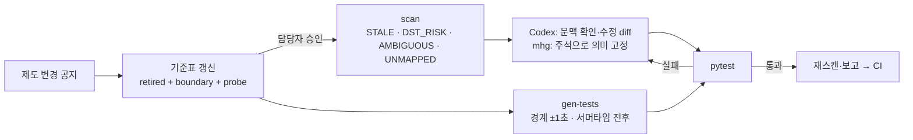

# 거래시간 변경 점검기 설계

문서 버전: 3.1 · 기준일: 2026-11-18 (Asia/Seoul)
스킬: `market-hours-guard` · 구현: [src/skills/market-hours-guard](../skills/market-hours-guard/SKILL.md) · 테스트: `tests/market_hours_guard/` (저장소 루트)
상태: 기존 플러그인(`safe-trade-rule-builder`, v0.2.0)의 두 번째 스킬로 추가. MVP 구현·검증 완료 (합성 저장소 기준).
근거: [MARKET_HOURS_EVIDENCE.md](MARKET_HOURS_EVIDENCE.md) · 이전 후보 이력: 저장소 `docs/reboot/archive/`

## 1. 한 문장

**카카오페이증권 개발자가 거래시간 제도 변경을 시스템에 반영하려는데, 시간 규칙이 세션 판정·주문 라우팅·배치·알림에 흩어져 있어 어디를 고쳐야 하는지 찾고 확인하기 어렵다. 이 플러그인은 영향 지점과 불일치를 찾고, 경계 시각 테스트로 동작까지 확인해 그 변경 작업을 끝내준다.**

## 2. 문제 근거

| # | 확인된 사실 | 출처 |
| --- | --- | --- |
| 1 | 카카오페이증권 MTS 장애 42건(2022.1~2026.3). 500만 계좌 이상 12개사 중 공동 1위, 4년 연속 증가한 유일한 회사 | E1 (금감원 자료) |
| 2 | 증권업권 전산장애 2022년 78건 → 2025년 113건. 2025년 금융권 전체는 줄었는데 증권만 11.9% 증가 | E3 (금감원 자료) |
| 3 | 거래시간이 계속 바뀌는 중: KRX 애프터마켓 2026-09-14 개장(16~20시), 프리마켓(07:50~) 추후 도입, 24시간이 목표 | E5 |
| 4 | 증권업계가 "전산 개발 부담과 시스템 안정성 우려"를 제기해 애프터마켓이 6월 → 9월로 연기 | E4, E5 |
| 5 | 개장 첫날, SOR 적용 시간이 15:30 → 20:00으로 늘어나 시스템을 바꾼 대형사 2곳에서 체결 조회 지연·취소주문 미처리 장애 | E6, E7 |
| 6 | 카카오페이증권은 NXT 모든 시장에 참여(2025-10-27~) — 같은 세션·SOR 변경의 영향권 | E8 |

## 3. 문제와 해결의 연결

이전 후보들이 실패한 지점은 "입증한 문제"와 "만든 기능" 사이의 간격이었다. 이번에는 간격을 명시한다.

| 구분 | 내용 |
| --- | --- |
| 입증된 것 | 거래시간 제도 변경이 진행 중이고 앞으로도 이어진다. 증권사들은 그 전산 변경을 공개적으로 부담이라 했고, 변경이 처음 적용된 날 실제 장애가 났다. 카카오페이증권은 장애 건수 최상위이고 같은 변경의 영향권에 있다. |
| 플러그인이 맡는 일 | 그 전산 변경 작업 중 **"어디를 바꿔야 하는지 찾고, 같은 기준으로 바꿨는지 확인하는"** 부분 |
| 주장하지 않는 것 | 카카오페이증권 장애 42건의 원인이 시간 로직이라는 것(원인 비공개). 9/14 장애가 하드코딩 때문이라는 것(업계는 시스템·메모리 증설 문제로도 해석). 용량·성능 문제 해결. |

"이 도구가 9/14 장애를 막았겠는가?"라는 질문에는 이렇게 답한다. 용량 문제였다면 막지 못한다. 이 도구가 다루는 것은 같은 변경에서 생기는 **로직·설정 누락**이다. 예를 들면 SOR 종료 상수, 정산 배치 시각, 세션 판정 분기, 서머타임 환산 같은 것들이다.

## 4. 이전 후보와 비교

| 후보 | 탈락·보류 이유 |
| --- | --- |
| Safe Trade Rule Builder (최초) | 감정적 매매라는 문제가 카카오페이증권 고유 근거로 입증되지 않음 |
| 고객 장애 기록 도우미 | 입증한 문제(장애)와 해결(문의서 작성) 사이 간격, 고객에게 Codex 사용 요구 |
| 배당세 정산 설명 | "설명해주면 편리" 수준, 꼭 필요한 작업이 아님 |
| 정책 정합성 검증기 (Codex 직전안) | 근거는 상담원의 말 오안내였는데 해결은 문서 대조라 연결이 약함. 단일 사건 |
| **거래시간 변경 점검기** | 금감원 통계(빈도·추세) + 진행 중인 제도 변경 + 첫날 장애 + 개발자가 Codex로 하는 실제 작업 |

## 5. 왜 Codex 플러그인인가

| 작업 | grep | 일반 채팅 | 이 플러그인 |
| --- | --- | --- | --- |
| `15:30` 찾기 | 찾지만 정규장 마감과 과거 SOR 종료를 구분 못 함 | 파일을 다 못 읽음 | 문맥 키워드로 구분, 애매하면 AMBIGUOUS |
| 서머타임 | `22:30`이 틀렸는지 모름 | 매번 계산이 다를 수 있음 | 기준 연도의 EST/EDT로 환산해 DST_RISK |
| 세션 자체가 빠진 누락 | 못 찾음 | 놓치기 쉬움 | 경계 시각 테스트로 검출 |
| 수정 | — | 복사·붙여넣기 | Codex가 문맥을 읽고 diff, `mhg:` 주석으로 의미 고정 |
| 다음 변경 | 처음부터 다시 | 처음부터 다시 | 기준표만 바꾸면 주석 단 지점이 MISMATCH로 자동 검출 |
| 재현성 | — | 낮음 | 같은 기준표 digest면 같은 결과, CI 종료 코드 |

판정은 결정적 코드(`scripts/mhg.py`)가, 문맥 해석·수정·질문은 Codex가 맡는다. 외부 API·MCP 서버·클라우드 의존성은 없다.

## 6. 사용자와 흐름

- 사용자: 카카오페이증권 트레이딩·MTS 백엔드 개발자, QA
- 승인자: 거래시간 기준(값·출처·적용일)을 확정하는 담당자

## 7. 판정 규칙

| 상태 | 조건 | 심각도 |
| --- | --- | --- |
| MISMATCH | `mhg: ID` 주석이 있는데 값이 기준표와 다름 | high |
| STALE | 폐기된 기준값과 같고, 그 기준의 문맥 키워드가 현행 기준보다 많이 일치 | high |
| DST_RISK | 외국 시장 경계를 현지 고정 시각으로 씀(계절 표시 없음) | high |
| AMBIGUOUS | 폐기·현행 기준에 같은 수준으로 해당하거나, 폐기값과 같은데 문맥 근거 없음 | medium |
| UNMAPPED | 거래시간 문맥인데 기준표에 없는 시각 | low |
| MATCH / IGNORED | 현행 기준과 일치 / `mhg: ignore` | info |

거래시간 문맥이 아닌 시각(예: 일일 리포트 07:00)은 보고하지 않는다. 타임스탬프(`2026-11-18T15:30:00+09:00`)는 규칙이 아니므로 제외한다.

## 8. 검증 결과

대상은 합성 저장소 `examples/toy-broker`(실제 회사 코드 아님)와 데모 기준표다. 기준표에서 공개 보도로 확인한 값과 `DEMO` 가정은 출처로 구분했다.

| 항목 | 수정 전 | 수정 후 |
| --- | --- | --- |
| 정적 스캔 | STALE 1 · DST_RISK 2 · AMBIGUOUS 1 · UNMAPPED 1 · MATCH 4 (종료 코드 1) | MATCH 16, 그중 주석 확정 15 (종료 코드 0) |
| 경계 테스트 50건 (수능일 14건, 연말휴장일 8건 포함) | 17 실패 | 50 통과 |

- 같은 `15:30`이 알림 코드에서는 MATCH(정규장 마감), 라우터에서는 STALE(과거 SOR 종료), 주문 컷오프에서는 AMBIGUOUS로 갈렸다.
- 정적 스캔은 통과했지만 테스트가 잡은 누락이 있다. 애프터마켓 세션이 빠져 16:00에 `CLOSED`를 돌려준 경우다.
- 미국 장 판정은 3월·7월 케이스를 통과하고 **11월 1일 서머타임 해제 이후 케이스에서만** 실패했다.
- 가상으로 SOR 종료를 21:00으로 바꾸면 주석을 단 2곳이 MISMATCH로 자동 검출됐다(라우터 상수, `SOR_END+5m` 정산 배치).
- **특수일(수능일, 2026-11-19 정규장 10:00~16:30, 애프터마켓 17:00~20:00)**: 평소 시각을 쓰는 세션 판정이 그날 8건 실패했다(09:00·09:59:59에 정규장으로, 15:30~16:29:59와 17:00~19:59:59에 장 종료로 판정). 정규장 이후 일정은 처음에 공지를 확인하지 못해 `confirmed_until`로 테스트에서 뺐고, 거래소 발표 보도를 확인한 뒤 넣었다.
- **휴장일(2026-12-31 연말휴장일)**: 휴장일을 모르는 세션 판정이 09:00·15:29:59를 정규장으로 판정해 2건 실패했다. 기준표의 휴장일은 한국거래소 휴장일 조회 자료(2026·2027년)를 그대로 옮겼고, 확인 범위(`confirmed_through`) 밖 날짜는 표본으로 쓸 수 없다.
- **Java판 합성 저장소**(`toy-broker-java`, Gradle·JUnit 5): 정적 스캔과 생성된 JUnit 경계 테스트 결과가 Python판과 같다(수정 전 50건 중 17건 실패, 수정 후 50건 통과). `LocalTime.of(...)`와 Spring 6필드 cron도 같은 판정을 받는다.
- **공개 저장소 5곳**(한국투자·키움 공식 예제 등): 처음 769건 중 547건이 오탐이었고, 원인 3가지를 고친 뒤 223건 중 오탐 0건. 한국투자 공식 예제에서 폐지된 시간외 단일가(16:00~18:00) 안내 9곳을 STALE로 찾았다. 자세한 내용: [MARKET_HOURS_REAL_REPOS.md](MARKET_HOURS_REAL_REPOS.md).
- **기준표 변경 영향 미리보기**(`impact`): SOR 종료를 21:00으로 바꾼 기준표를 넣으면 수정된 저장소에서 주석을 단 2곳이 새로 MISMATCH가 되고, 주석 없는 설명 문구 1곳은 다른 기준(애프터마켓 종료)으로 해석이 바뀐다고 미리 보여 준다.
- **SARIF**: `scan --sarif`로 GitHub code scanning에 올릴 수 있다. 출력은 SARIF 2.1.0 스키마 검증을 통과했고, 이 저장소의 CI가 런타임 세션 설정을 스캔해 올린다.
- 스킬 자체 테스트 79개(JDK·JUnit이 있으면 Java 실행 2개 포함) 통과, ruff 통과.

## 9. 범위 밖과 한계

- 시스템 용량·성능, 거래소·SOR 제공사 장애, 실주문.
- 정적 패턴 밖의 시각 계산(분 단위 산술), DB·원격 설정에 저장된 값. 휴장일은 경계 테스트에서만 확인하고, 코드에 적힌 날짜 목록을 정적으로 대조하지는 않는다.
- MATCH는 값이 기준표에 있다는 뜻이다. 공개 저장소 평가에서 MATCH 97건 중 37건은 값만 같았다. 수능일 기준을 문맥이 있을 때만 맞추도록 고쳐 80건 중 20건으로 줄였고, 남은 것은 일본 장 09:00 ↔ KRX 정규장 시작 같은 흔한 시각이다.
- 1MB를 넘는 파일은 읽지 않는다(출력과 보고서에 목록 표시). 주변에 거래 관련 단어가 없는 시각은 보고하지 않을 수 있다.
- 실제 KRX 세션 세부(동시호가, 시간외 종가 등)는 데모 기준표에 넣지 않았다. 실사용 기준표는 회사가 작성·승인한다.
- 실제 카카오페이증권 저장소에서의 효과는 측정하지 않았다.

## 10. 기존 플러그인과의 관계

예선 이후 추가 개발이므로 기존 Safe Trade Rule Builder를 교체하지 않고 같은 플러그인에 스킬을 더했다. `plugin.json`의 `"skills": "./skills/"`가 두 스킬을 함께 로드한다.

| 스킬 | 사용자 | 다루는 문제 |
| --- | --- | --- |
| `safe-trade-rule-builder` | 초보 투자자 | 감정적 매매 의도를 안전장치가 있는 룰 초안으로 |
| `market-hours-guard` | 증권사 개발자·QA | 거래시간 제도 변경의 전산 반영 누락 |

처음 추가했을 때 기존 `src/` 전체를 검사한 결과는 0건이었다. 런타임은 거래소 상태를 이벤트(`exchange_status`)로 받고 시각을 직접 계산하지 않기 때문이다. 이후 세션 판정을 로컬 런타임(`src/runtime/market_sessions.py`, `market_sessions.json`)으로 모아 투자자용 스킬과 함께 쓰게 했고, 애프터마켓과 수능일 일정을 넣었다. 이 스킬로 투자자용 스킬과 런타임을 검사하면 거래시간 값(정규장·애프터마켓·수능일·미국 정규장·미국 조기 폐장·오전 기준)이 모두 기준표와 일치하고, 휴장일 달력도 기준표와 같다. `tests/market_hours_guard/test_mhg_dogfood.py`가 이 상태를 지킨다.

## 11. 남은 일

1. 휴장일 달력 갱신: 한국거래소·NYSE가 2028년 휴장일을 공지하면 기준표와 `market_sessions.json`에 함께 넣는다(두 파일이 같은지 테스트가 확인한다).
2. 원문 재확인: [MARKET_HOURS_EVIDENCE.md](MARKET_HOURS_EVIDENCE.md)의 수치·인용을 원문과 한 번 더 대조한다.
